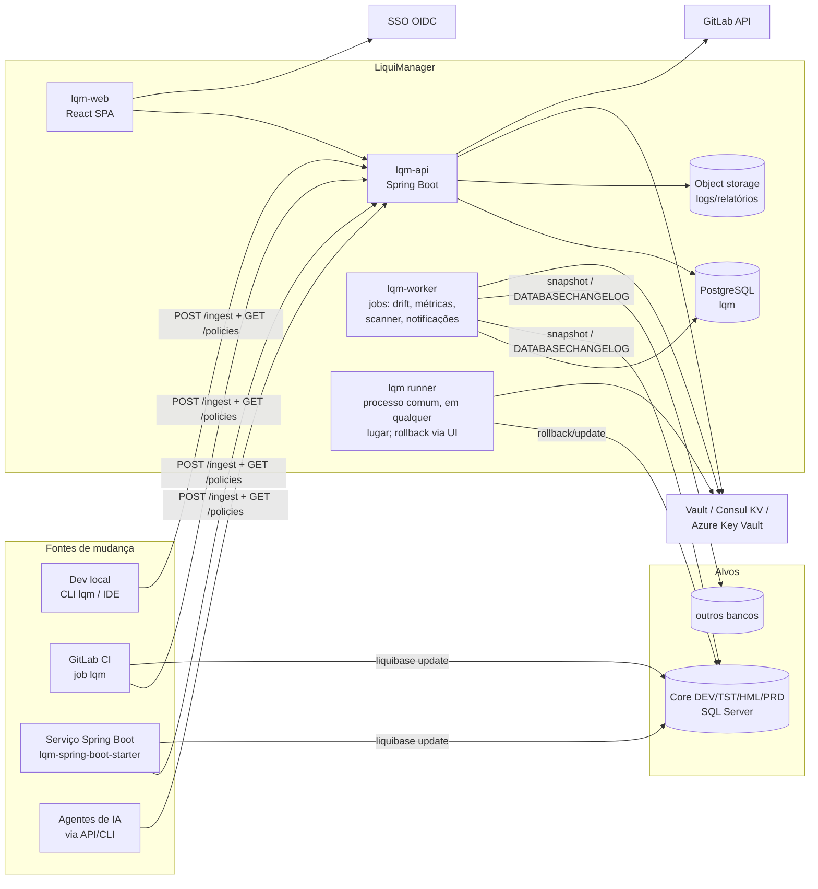
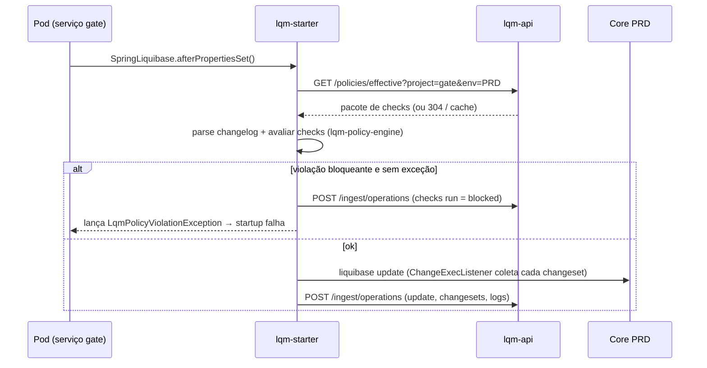

# 04 — Arquitetura

## 1. Visão de componentes



## 2. Stack (alinhada a serviços Spring Boot 3.4 / Java 21 com Liquibase)

| Camada | Tecnologia | Motivo |
|--------|-----------|--------|
| Backend API | Java 21, **Spring Boot 4.x** (Spring Framework 7; ver D-18), Spring Web, Spring Security (OAuth2 Resource Server), Spring Data JPA, Flyway **não** — usar **Liquibase** (dogfooding) | Mesmo padrão dos serviços em `backend/` |
| Motor Liquibase | `org.liquibase:liquibase-core` **5.x** (FSL — uso interno; ver D-17) como biblioteca | Parse de changelog, geração de SQL, diff/snapshot sem depender de Pro |
| Jobs | Spring Scheduling + ShedLock; ou módulo `lqm-worker` separado | Lock distribuído com 2+ réplicas |
| Banco do LiquiManager | PostgreSQL 16 (decisão D-01; alternativa SQL Server) | JSONB para payloads, particionamento por data |
| Tempo real | Server-Sent Events (`SseEmitter`) | Simples, unidirecional |
| Frontend | React 19 + Vite 7 + TypeScript + Tailwind 4 + TanStack Query 5 + Zustand + lucide-react | Mesmo stack de `frontend/portalwebinternal` |
| Tabelas | TanStack Table v8 | Ordenação/paginação server-side |
| Gráficos | Recharts (ou ECharts) | Barras + linha da tela de drift |
| Editor de código | Monaco Editor (somente leitura no Developer Mode) | Realce XML/YAML/SQL |
| CLI | Picocli + `liquibase-core`, distribuído como jar e imagem `lqm-cli` | Executar em CI e local |
| Starter | `lqm-spring-boot-starter` (auto-configuration), compilado contra **Spring Boot 3.4.x** | Serviços que rodam Liquibase no startup. É o único módulo que não acompanha a linha 4.x — ver D-18 |
| Observabilidade | Micrometer + Prometheus, OpenTelemetry, logs JSON (logstash-encoder) | Padrão do cluster |
| Deploy | Imagens OCI (`lqm-api`, `lqm-cli`, `lqm-web` em Nginx, que lê no start `LQM_API_URL`, `LQM_OIDC_AUTHORITY` e `LQM_OIDC_CLIENT_ID`: a mesma imagem serve todos os ambientes e faz proxy de `/api`, inclusive do SSE, sem buffer); Docker Compose para o ambiente local e para um host único; manifests de Kubernetes como **uma** opção, nunca um requisito (D-19). GitLab CI (`ci-cd/ci-templates`) | Onde rodar é de quem opera |

## 3. Módulos do repositório (monorepo proposto)

```
liquimanager/
├── docs/                         # esta especificação
├── lqm-api/                      # Spring Boot — REST + SSE + segurança
│   └── src/main/java/io/github/carloslimajlle/liquimanager/
│       ├── catalog/              # workspaces, projetos, changelogs, ambientes, conexões, pipelines
│       ├── ingest/               # recebimento e normalização de operações
│       ├── operations/           # consultas de operações e changesets
│       ├── matrix/               # deployment matrix
│       ├── policy/               # biblioteca, pacotes, avaliação, exceções
│       ├── drift/                # execuções e itens de drift
│       ├── metrics/              # DORA, KPIs materializados
│       ├── security/             # RBAC, SoD, tokens
│       ├── audit/                # trilha imutável
│       └── secrets/              # provedores Vault/Consul/AKV
├── lqm-policy-engine/            # biblioteca pura (sem Spring Boot; só spring-expression, D-21) com os checks — usada por api, cli e starter
├── lqm-core-client/              # cliente HTTP da API + modelos de payload (usado por cli e starter)
├── lqm-cli/                      # Picocli
├── lqm-spring-boot-starter/      # auto-config
├── lqm-worker/                   # jobs (pode iniciar dentro da api, separar depois)
├── lqm-web/                      # React SPA
└── deploy/                       # docker-compose local e exemplos (runner, Keycloak, SQL Server, k8s)
```

**Regra importante:** `lqm-policy-engine` é a mesma biblioteca usada no servidor, na CLI e no starter —
o resultado de um check é idêntico onde quer que rode. As **definições** de políticas vêm da API
(`GET /api/v1/policies/effective?project=…&env=…`) e ficam em cache local com TTL; offline, usa o último cache.

## 4. Fluxos principais

### 4.1 Update no startup de um serviço (caso atual dos projetos)



### 4.2 Update em pipeline (recomendado para PRD — ver decisão D-05)

Job GitLab `db-migrate` antes do deploy do serviço executa `lqm flow --env=PRD`. O serviço sobe com
`spring.liquibase.enabled=false` em PRD (ou com o starter apenas validando `status`).

### 4.3 Drift agendado

`lqm-worker` → para cada conexão com drift ligado, no cron configurado: resolve segredo → snapshot do banco
(`SnapshotGeneratorFactory`) → compara com **snapshot de referência** → grava `drift_run` + `drift_item` → notifica.

Snapshot de referência (decisão D-06):
1. **Banco de referência**: compara com outro ambiente (ex.: HML) — simples, mas herda drift do outro;
2. **Último snapshot limpo**: snapshot tirado logo após cada `update` com sucesso, salvo em JSON (`SnapshotSerializer`) — **recomendado**;
3. **Banco efêmero**: aplica o changelog num SQL Server em container (Testcontainers) e tira o snapshot — mais fiel, mais caro.

### 4.4 Rollback pela UI

UI → `POST /operations/{id}/rollback-requests` → aprovação (SoD) → um **runner** (`lqm runner`, um processo comum que puxa o
trabalho) pega o pedido aprovado, busca o changelog no Git no commit da operação original, executa
(`rollback-to-changeset` ou `rollback --tag`) → reporta nova operação com `parentOperationId`.

**"Voltar até um changeset"** é como o `rollbackCount` do Liquibase, só que com a lista à vista: desfaz o changeset escolhido **e tudo o que foi
aplicado depois dele naquela conexão, do mais novo para o mais antigo**. Um changeset do meio nunca é desfeito sozinho: o seguinte pode
depender dele (uma coluna sobre a tabela) e, sem o primeiro, ficaria registrado como aplicado sobre algo que não existe mais. Antes de pedir, a tela
mostra a lista (`GET /operations/{id}/rollback-preview?changeset=`), com o autor, a data e o que não tem rollback; o pedido guarda essa lista
(`plan`), quem aprova vê a mesma lista, e o runner só executa se o `DATABASECHANGELOG` do banco disser o mesmo: se algo foi aplicado ou desfeito
no meio do caminho, falha sem desfazer nada e a pessoa pede de novo.

**Onde se pede.** Na aba **Rollback** do projeto (`/projects/:id?tab=rollback`): escolhe-se o banco, vê-se o que está aplicado nele, do mais novo para o mais antigo
(`GET /connections/{id}/applied-changesets`), e cada linha tem **Voltar até aqui**, que abre a lista exata do que será desfeito. Os pedidos do banco ficam logo abaixo,
com aprovar, rejeitar e cancelar (`GET /rollback-requests?connection=`). O painel *Rollbacks* da operação continua existindo, com o pedido por tag.

A API **não cria Jobs, contêineres nem processos**: ela não precisa de direito algum sobre onde o runner roda, e o produto não exige
Kubernetes nem nenhum outro orquestrador (D-19).

> Observação: `rollback-one-changeset` (desfazer um só, onde estiver) é comando **Pro** no Liquibase. No LiquiManager ele existe na CLI, para uso de quem
> sabe o que faz, e a UI **não** o oferece pelo risco acima. Ele é implementado na CLI usando a API
> do `liquibase-core`: localizar o `ChangeSet`, gerar as `rollback` statements (`ChangeSet.rollback(Database)`),
> executar e remover a linha da `DATABASECHANGELOG` via `ChangeLogHistoryService.removeFromHistory`.
> O mesmo vale para `checks`, `flow`, relatórios de operação e saída JSON de `diff` — tudo que é Pro é reimplementado no LiquiManager.

### 4.5 Análise por IA (futuro, desativada)

Não implementar nas fases 0–3 (D-13). Desenho previsto, para quando for ligada: UI →
`POST /operations/{id}/ai-analyses` → API monta prompt com erro, changeset (XML/SQL), SQL gerado,
engine/versão, histórico do changeset nos outros ambientes e achados de checks → modelo → resposta em JSON
estruturado (`summary`, `rootCause`, `steps[]`, `suggestedSql`, `confidence`) → salva → exibe.

O provedor não está escolhido e a integração não entra na stack agora; quando entrar, vira um módulo
`ai/` em `lqm-api` e exige aprovação de Segurança (RNF-17) e `ai_enabled = true` no workspace.

## 5. Implantação

| Recurso | DEV | HML | PRD |
|---------|-----|-----|-----|
| lqm-api | 1 réplica | 2 | 2–3 (HPA) |
| lqm-worker | dentro da api | 1 | 1 (ShedLock permite 2) |
| lqm-web | Nginx 1 | 2 | 2 |
| PostgreSQL | container | gerenciado | gerenciado com backup PITR |
| Ingress |  `liquimanager.dev.<domínio>` |  `liquimanager.hml.<domínio>` | `liquimanager.<domínio>` (D-10) |

Rede: o `lqm-worker` e o `lqm-runner` precisam de rota até **todos** os bancos monitorados (liberar firewall — D-11).

## 6. Decisões arquiteturais (ADRs resumidos)

| ADR | Decisão | Alternativas descartadas |
|-----|---------|--------------------------|
| 001 | Usar `liquibase-core` OSS como biblioteca, nunca CLI em subprocesso. **Validar na Fase 0** as APIs internas do § 4.4 contra a 5.x (mudaram desde a 4.x) | Parsear stdout do CLI (frágil) |
| 002 | Motor de políticas próprio em biblioteca compartilhada | Usar Liquibase Pro checks (licença) |
| 003 | Ingestão push (coletores) + pull (scanner) | Somente pull (perde logs/SQL e contexto) |
| 004 | Coletores **fail-open** por padrão | Fail-closed (LiquiManager viraria ponto único de falha do deploy) |
| 005 | SSE para tempo real | WebSocket (desnecessário) |
| 006 | Auditoria em tabela append-only com hash encadeado | Log externo (mais difícil de consultar) |

## Estado da implementação: jobs

Como o próprio documento prevê (tabela de componentes), os jobs rodam **dentro da `lqm-api`**, com `@Scheduled` e ShedLock
(`lqm.jobs.enabled`, ligado por padrão). Cada execução fica em `job_run`.

Dois jobs cuidam da higiene, e os prazos são do workspace (`PUT /workspaces/{id}/settings`, tela Configurações): `retention` (03:30) apaga o
histórico dos próprios jobs e as notificações já enviadas, e `promotion-expiry` (a cada 15 min) expira o pedido de promoção que ninguém decidiu
no prazo (`EXPIRED`, com evento de auditoria; 0 desliga). Operações e auditoria não são apagadas por aqui (D-08).

**O worker é a mesma imagem da API em outro papel (D-20).** Réplicas web sobem com `LQM_JOBS_ENABLED=false` e uma ou mais réplicas
só de jobs sobem com `true` e sem porta publicada; o ShedLock impede que duas rodem o mesmo job. É o perfil `worker` do
`deploy/docker-compose.yml`. O módulo `lqm-worker` segue vazio de propósito: o que os jobs usam (auditoria, persistência de drift,
métricas) mora na API, e extrair um módulo compartilhado custaria mais do que rende, sem mudar nada do que o operador consegue
fazer. Se um dia o worker precisar de dependências ou ciclo de release próprios, o módulo existe para recebê-lo.

## Estado da implementação: rollback pela UI (E17)

Implementado como **runner que puxa** (pull), sem a API criar nada (D-19):

1. `POST /operations/{id}/rollback-requests` (até um changeset, ou até uma tag). Exige `rollback:<ambiente>`. Em produção a solicitação espera
   outra pessoa com `rollback:approve` que não seja o autor de **nenhum** dos changesets da lista (SoD-1, SoD-2, `LQM-010`); nos demais ambientes é
   aprovada na hora. Algum changeset da lista sem rollback e não auto-reversível: `LQM-040`, dizendo qual.
2. `lqm runner [--once]` (token com escopo `runner`) pega a solicitação aprovada mais antiga (`POST /runner/claim`), clona o projeto no
   **commit da operação mais nova da lista** (`--git-url`; é a que tem, no changelog, tudo o que será desfeito) ou usa o checkout em `--workdir`, executa
   `rollback-to-changeset --expect …` ou `rollback --tag` e
   relata uma nova operação com `parentOperationId`, e então `POST /runner/requests/{id}/complete`.
3. A API **não cria Jobs nem processos** (D-19). O runner é um processo comum, com dois modos: **serviço** (`lqm runner`: consulta a cada
   `--poll-seconds`, executa, volta a consultar; em SIGTERM termina o rollback em andamento antes de sair, por até `--grace-seconds`) e
   **pontual** (`lqm runner --once`: pega no máximo um pedido e sai, para cron, pipeline agendada ou CronJob). Quem o sobe fica fora do
   código: há exemplos para Docker Compose, systemd, cron, GitLab CI e Kubernetes (como uma opção) em `deploy/examples/runner/`. Pode haver
   vários runners ao mesmo tempo: o pedido é entregue a um só (`for update skip locked`). As credenciais do banco são as do runner; o
   LiquiManager nunca as envia.
4. Uma solicitação `RUNNING` há mais de 30 minutos é marcada `FAILED` por um job.

`rollback-to-changeset` calcula a lista com `ChangeLogHistoryService.getRanChangeSets` e desfaz com o `rollbackCount` do próprio Liquibase (mesma ordem e
mesmo registro no histórico); `rollback-one-changeset` usa `ChangeSet.rollback`, `removeFromHistory` e o `LockService` do Liquibase 5.0.4 (D-17).
Testes rodam as duas sequências contra um banco real.


## Estado da implementação: solicitação automática de aprovação

Um estágio que **exige aprovação** pode ligar **Solicitar aprovação automaticamente** (`pipeline_stage.auto_request`, desligado por padrão).
Quando um deploy com changesets executados é reportado para o estágio **imediatamente anterior** (por exemplo o merge que aplica em DEV), a
promoção do estágio seguinte abre sozinha como `REQUESTED`, em nome de `system`, com a release do deploy e um evento de auditoria
`pipeline.promote.request`. Nada dispara: a aprovação continua sendo de **outra** pessoa com `promote:<ambiente>` (SoD-2; `system` nunca
aprova), e o `lqm update` ainda confere a ordem dos ambientes (D-22). Há no máximo uma solicitação aberta por estágio, deploy com falha ou
sem changeset executado não pede nada, e uma falha ao abrir o pedido nunca desfaz o que foi reportado. A solicitação expira como qualquer outra
(`promotion_ttl_hours`). Código: `AutoPromotionRequests`.

## Estado da implementação: pendências para o usuário

O sino do topo de **todas** as telas mostra um contador do que espera a decisão da pessoa logada. `GET /me/pending` lista só o que ela poderia
mesmo aprovar: promoções (`promote:<ambiente>`), pedidos de rollback (`rollback:approve`) e exceções de política (`exception:approve`) em
`REQUESTED`, que outra pessoa pediu (SoD-2) e que não são sobre um changeset que ela escreveu (SoD-1). Cada linha leva à tela onde se decide
(matriz do pipeline, operação, Enforcement). O pedido que a própria pessoa abriu não conta para ela; o que aguarda os outros continua nas telas
de cada fluxo. Código: `PendingController`, `shell/PendingBell.tsx`.

**O aviso chega na hora, no topo.** Quando há algo para decidir, uma faixa no topo de toda tela diz quantas pendências são, descreve a primeira e leva
a ela (`shell/PendingBanner.tsx`); dispensar esconde o que está aberto agora, e o que chegar depois traz a faixa de volta. O contador também vai para o
título da aba. Nada disso depende de consulta periódica: o servidor avisa pelo mesmo stream SSE do dashboard (`GET /stream/operations`) com o evento
`pending.changed`, sem conteúdo, e cada tela pergunta de novo o `/me/pending` da própria pessoa (a lista é por pessoa, o aviso não carrega dado de
ninguém). Ele sai depois que um pedido de promoção, rollback ou exceção de política é aberto, aprovado, rejeitado, cancelado ou revogado
(`PendingBroadcast`, que escuta essas rotas) e quando o pedido automático abre uma promoção (`AutoPromotionRequests`). Reconectar o stream também
consulta de novo, para pegar o que aconteceu enquanto ele estava fora. Resta uma consulta a cada 5 min e ao voltar o foco para a janela, só como rede
de segurança (um pedido que expira, por exemplo, não é anunciado). Com mais de uma réplica da API, o aviso chega a todas pelo barramento do cluster (próxima seção).

## Estado da implementação: o projeto e o changeset como telas

Duas telas respondem a "de qual aplicação é isso" e "onde esse changeset está", ambas só de leitura:

- **`/projects/:id`** (item *Projetos* na barra lateral; o cadastro continua em Administrar): **Resumo** (KPIs das operações do projeto,
  o que cada ambiente guarda: executados, com falha, revertidos, último deploy), **Changesets** (todos os do projeto, uma coluna de status por
  ambiente; busca, filtro por status) e **Operações**. `GET /projects/{id}/changesets` e `/changesets/summary`.
- **`/changesets/:id`**: identidade (autor, arquivo, checksum, labels), o estado em cada banco, as operações que o executaram, o que as
  políticas disseram e os rollbacks pedidos. `GET /changesets/{id}`. O SQL não está aqui: ele é guardado por operação (aba SQL da operação).

Nas listas (dashboard, Todas as operações) projeto, changelog e changeset são links. O ambiente de um changeset vem de `changeset_state`,
então vale também para conexões que a ingestão criou e ninguém vinculou ao projeto. Código: `ChangesetController`, `features/projects/`.

### O que o changeset faz, na hora de aprovar

`GET /changesets/{id}/source` lê do repositório (GitLab, `RepositoryFiles`) o arquivo do changeset e marca as linhas dele, com o rollback
que carrega (XML, YAML e SQL formatado; `ChangesetBlocks`). Lê da branch padrão primeiro, o que uma promoção vai rodar, e depois dos
commits das operações que o avaliaram, o que serve a um changeset que ainda está num merge request. Quando não consegue, responde 200
com `found: false` e o motivo (sem URL de repositório, GitLab não configurado, arquivo não encontrado, GitLab fora do ar), para a tela
dizer o que corrigir.

A tela do changeset mostra isso, e cada aprovação traz o seu: a promoção lista o que vai aplicar (`GET /promotions/{id}/changes`: executado no
estágio anterior e ainda não neste) e o rollback mostra o changeset a reverter, cada um a um clique de ler o que faz.

### A governança dentro do projeto

A página `/projects/:id` ganhou quatro abas, para ver a aplicação inteira num lugar só:

- **Políticas:** os achados dos gates das operações do projeto, contados por resultado (`GET /projects/{id}/findings`), e as exceções que o cobrem.
- **Drift:** a última verificação de cada banco do projeto (`GET /projects/{id}/drift`). Um banco nunca verificado aparece como tal, não como limpo.
- **Pipelines:** os pipelines do projeto com os estágios em ordem (quais exigem aprovação e quais pedem sozinhos) e os atalhos para a matriz,
  a linha do tempo e o Enforcement.
- **Aprovações:** tudo do projeto que espera decisão (`GET /projects/{id}/approvals`), com quem pediu e se a pessoa logada pode decidir
  (permissão no escopo, SoD-1 e SoD-2). Cada pedido traz o que ele faz: a promoção lista o que aplicaria e cada changeset abre a definição.
  `/me/pending` é a mesma lista restrita ao que a pessoa pode decidir, em todos os projetos.

As abas só leem. Decidir continua nas telas de cada fluxo, a um clique. Código: `ProjectGovernanceController`, `PendingController`,
`features/projects/ProjectGovernance.tsx`.

### Changeset editado depois de aplicado

Liquibase guarda no banco o checksum de cada changeset que rodou e recusa o deploy inteiro se o arquivo passar a dar outro. O MR não vê isso: ele
roda contra um banco efêmero. O `ChecksumChanged` fecha o buraco: o servidor guarda por banco o checksum e o commit com que cada changeset foi
executado (`changeset_state.applied_checksum` e `applied_commit`; só uma execução ou o scanner os grava, nunca um "já executado", que traz o
checksum do arquivo e não o do banco) e `POST /policies/checksum-check` compara com o que o coletor calcula agora. O achado traz as linhas que
mudaram, sem comentários, e distingue o que parece equivalente (só avisa) do que muda a estrutura (bloqueia). `GET /changesets/{id}/versions` e a
tela do changeset mostram a versão aplicada contra a atual. Bancos que já tinham changesets antes desta coluna só passam a ser comparados quando
uma execução ou uma varredura do scanner registrar o checksum. Código: `ChecksumChecks`, `BlockDiff`, `ChecksumGate`.

**A promoção avisa antes do clique.** O diálogo "Promover para HML" pergunta ao servidor (`GET /pipelines/{id}/stages/{stageId}/preview`) o que a promoção vai
encontrar: o que o estágio anterior rodou e este ainda não (`ready`), o que foi **editado depois de rodar lá** (`edited`, com o checksum de cada versão) e o que o
changelog tem e nenhum dos dois rodou (`notInPrevious`). Os dois últimos o deploy barra (D-22), então a pessoa sabe agora e não por um pipeline que para.
O diálogo só informa; quem barra é o deploy.

## Estado da implementação: mais de uma réplica da API

A API roda em 2 ou mais réplicas sem nada novo ao lado do Postgres e do armazenamento de objetos. O que cada réplica guardava só para si foi
levado para onde todas enxergam:

| O que era local | Agora |
|-----------------|-------|
| O feed ao vivo (`operation.ingested`) e o aviso de pendências (`pending.changed`) | `ClusterBus`: Postgres `LISTEN/NOTIFY`, canal `lqm_events`. Quem publica **não** entrega direto: toda réplica, a que publicou inclusive, entrega ao seu navegador o que ouve do banco. O ouvinte tem conexão própria (fora do pool) e reconecta sozinho; enquanto ele está fora, a réplica entrega só aos seus assinantes, então uma réplica sozinha continua funcionando. Uma notificação cabe em 8000 bytes: acima de 7500 ela vai sem os dados, que servem de dica (a tela consulta o servidor) |
| O cache de segredos (até 5 min por réplica) | A rotação avisada a uma réplica (`POST /secrets/{conexão}/rotated`) publica `secrets.evict`, e todas esvaziam o cache (`SecretCacheSync`) |
| Logs e SQL das operações num diretório local | `lqm.storage.type=s3` (`S3BlobStore`, qualquer serviço compatível com S3; no ambiente local, o RustFS): a referência vira `s3:<chave>`, e uma referência `fs:` antiga continua legível depois da troca (`RoutingBlobStore`). Sem isso um log gravado por uma réplica dá 404 na outra |
| Jobs agendados | Já eram seguros: cada job tem um lock no banco (ShedLock, relógio do banco) e só uma réplica o roda por vez |

O que já estava no banco e por isso vale para todas: o estado do break-glass (tentativas, bloqueio, passo TOTP e sessões), a cadeia de hashes
da auditoria (lock consultivo), a ingestão idempotente, a fila de notificações e a reivindicação do runner (`for update skip locked`).
O que continua por réplica, de propósito e sem efeito visível: o cache do `PrincipalSync` (só evita reescrever o mesmo principal a cada
chamada) e a avaliação de escopo do feed, calculada quando o navegador conecta (uma mudança de binding vale na próxima conexão, em até 30 min).

Para exercitar: `docker compose -f deploy/docker-compose.yml -f deploy/docker-compose.ha.yml up -d --build api api2 minio` (a segunda réplica
fica na 8083; combina com `docker-compose.oidc.yml`). Em produção, ponha um balanceador na frente e use readiness como health check. O SSE passa
por proxies: mantenha o *idle timeout* acima de 20 s (a API manda um comentário a cada 20 s). Código: `ClusterBus`, `OperationStream`,
`SecretCacheSync`, `S3BlobStore`, `RoutingBlobStore`; testes: `ClusterBusIntegrationTest` (duas réplicas simuladas sobre o mesmo banco),
`S3BlobStoreTest` (com `LQM_S3_TEST_ENDPOINT`, contra um servidor de verdade).
