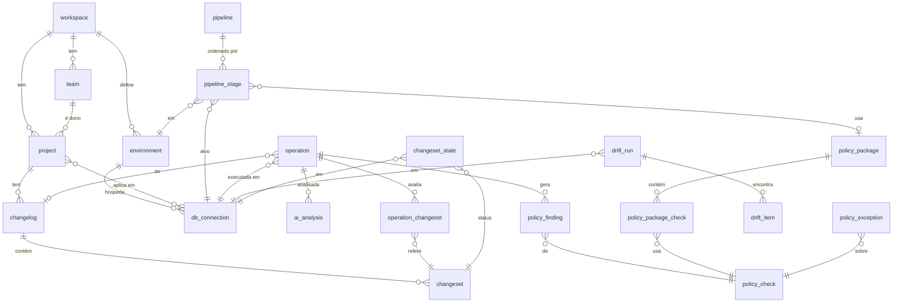

# 05 — Modelo de dados

Banco do próprio LiquiManager (PostgreSQL 16, ver D-01). Versionado com Liquibase em
`lqm-api/src/main/resources/db/changelog/`. Convenções: `snake_case`, PK `uuid` (v7, ordenável),
timestamps `timestamptz` em UTC, soft delete via `archived_at`, `workspace_id` em toda entidade de negócio.

## 1. Diagrama



## 2. Tabelas

### 2.1 Catálogo

```sql
create table workspace (
  id uuid primary key, slug varchar(64) unique not null, name varchar(120) not null,
  ai_enabled boolean not null default false,  -- IA e feature futura e nasce desligada (D-13)
  created_at timestamptz not null default now()
);

create table team (
  id uuid primary key, workspace_id uuid not null references workspace,
  name varchar(120) not null, unique (workspace_id, name)
);

create table project (
  id uuid primary key, workspace_id uuid not null references workspace, team_id uuid references team,
  slug varchar(64) not null, name varchar(120) not null, repo_url varchar(500), default_branch varchar(120) default 'main',
  description text, archived_at timestamptz, unique (workspace_id, slug)
);

create table environment (
  id uuid primary key, workspace_id uuid not null references workspace,
  code varchar(16) not null,            -- DEV, TST, HML, PRD
  name varchar(60) not null,            -- Desenvolvimento, Teste, Homologação, Produção
  sort_order int not null, color_token varchar(20) not null, -- env-dev, env-tst, env-hml, env-prd
  is_production boolean not null default false, requires_approval boolean not null default false,
  unique (workspace_id, code)
);

create table db_connection (
  id uuid primary key, workspace_id uuid not null references workspace, environment_id uuid not null references environment,
  slug varchar(80) not null,            -- core-prd  (connectionKey usado pelos coletores)
  display_name varchar(120) not null,   -- "Core PRD"
  engine varchar(30) not null,          -- SQLSERVER | POSTGRESQL | ORACLE | MYSQL | ...
  jdbc_url varchar(500) not null,       -- SEM usuário/senha
  default_schema varchar(120),
  host_fingerprint varchar(200) not null, -- host:porta/database normalizado, p/ match de operações
  secret_provider varchar(20),          -- VAULT | CONSUL | AZURE_KV | NONE
  secret_ref varchar(300),              -- ex.: secret/data/lqm/core-prd
  secret_rotated_at timestamptz,
  drift_enabled boolean not null default false, drift_cron varchar(60) default '0 0 */6 * * *',
  scanner_enabled boolean not null default true, scanner_interval_min int default 15,
  db_version varchar(120), last_test_at timestamptz, last_test_ok boolean,
  verified boolean not null default true,  -- false quando criada pela ingestao, ate um admin confirmar
  archived_at timestamptz, unique (workspace_id, slug)
);

create table project_connection (
  project_id uuid references project, db_connection_id uuid references db_connection,
  primary key (project_id, db_connection_id)
);

create table changelog (
  id uuid primary key, project_id uuid not null references project,
  name varchar(120) not null,           -- gate-changelog
  path varchar(500) not null,           -- src/main/resources/db/changelog/db.changelog-master.xml
  format varchar(20) not null,          -- XML | YAML | JSON | SQL
  policy_package_id uuid,               -- FK adicionada após policy_package
  verified boolean not null default true,
  reconciled_at timestamptz,            -- início do último relatório completo usado para marcar changesets removidos
  unique (project_id, path)
);

create table pipeline (
  id uuid primary key, workspace_id uuid not null references workspace,
  name varchar(80) not null,            -- SDLC-GATE
  project_id uuid references project, gitlab_project_id bigint, gitlab_trigger_ref varchar(120)
);

create table pipeline_stage (
  id uuid primary key, pipeline_id uuid not null references pipeline,
  sort_order int not null, environment_id uuid not null references environment,
  db_connection_id uuid not null references db_connection, policy_package_id uuid,
  requires_approval boolean not null default false, unique (pipeline_id, sort_order)
);
```

### 2.2 Changesets e estado

```sql
create table changeset (
  id uuid primary key, changelog_id uuid not null references changelog,
  cs_id varchar(255) not null, author varchar(255) not null, file_path varchar(500) not null, -- identidade Liquibase
  checksum varchar(64),                 -- MD5SUM/ checksum v9 do Liquibase
  labels varchar(500), contexts varchar(500), comments text,
  has_rollback boolean not null,        -- rollback explícito ou auto-reversível
  is_break_fix boolean not null default false,
  first_seen_at timestamptz not null default now(),
  removed_at timestamptz,               -- saiu do changelog na branch principal (relatório completo); nulo se ainda está lá
  removed_commit varchar(80),           -- o commit do relatório que notou a falta
  seen_on_default_at timestamptz,       -- quando um relatório da branch principal o listou; nulo = só existe em MR/branch (fora do changelog)
  origin_branch varchar(255), origin_mr_iid varchar(40), origin_mr_title varchar(300), origin_mr_url varchar(500), -- de onde veio, enquanto seen_on_default_at é nulo
  origin_seen_at timestamptz,           -- o último relatório da branch/MR que o listou
  dismissed_at timestamptz, dismissed_by varchar(120), dismissed_note text, -- o grupo foi encerrado por uma pessoa (MR fechado/deletado); um relatório novo da branch desfaz
  unique (changelog_id, cs_id, author, file_path)
);

-- Último estado conhecido de cada changeset em cada banco (alimenta a Deployment Matrix)
create table changeset_state (
  changeset_id uuid references changeset, db_connection_id uuid references db_connection,
  status varchar(20) not null,          -- EXECUTED | FAILED | ROLLED_BACK | PENDING | NOT_TARGETED | OUT_OF_PROCESS
  exec_type varchar(20),                -- EXECUTED | RERAN | MARK_RAN (da DATABASECHANGELOG)
  last_operation_id uuid, deployed_at timestamptz, deployment_id varchar(20), tag varchar(255),
  primary key (changeset_id, db_connection_id)
);
```

### 2.3 Operações (particionada por mês)

```sql
create table operation (
  id uuid not null,                     -- operationId gerado pelo coletor (idempotência)
  workspace_id uuid not null, project_id uuid, changelog_id uuid, db_connection_id uuid not null,
  command varchar(40) not null,         -- update | update-count | update-to-tag | update-sql | rollback | rollback-count | rollback-to-date | rollback-one-changeset | rollback-to-changeset | tag | status | history | snapshot | diff | diff-changelog | validate | checks run | flow | observed
  type varchar(30) not null,            -- database-change | policy-checks | drift | read-only
  status varchar(20) not null,          -- SUCCESS | FAILURE | BLOCKED | RUNNING | CANCELED
  source varchar(20) not null,          -- pipeline | startup | cli-local | scheduler | ui | scanner
  executed_by varchar(120) not null,    -- usuário ou serviço
  started_at timestamptz not null, ended_at timestamptz, duration_ms bigint,
  deployment_id varchar(20),            -- DEPLOYMENT_ID da DATABASECHANGELOG
  liquibase_version varchar(30), collector varchar(40), collector_version varchar(20),
  contexts varchar(500), labels varchar(500), tag varchar(255),
  git_commit varchar(64), git_branch varchar(255),
  ci_pipeline_id varchar(60), ci_job_url varchar(500),
  host varchar(255), exit_code int,
  count_executed int default 0, count_previously_run int default 0, count_filtered int default 0, count_failed int default 0,
  error_message text, log_ref varchar(500), sql_ref varchar(500), -- logs grandes vão para object storage
  parent_operation_id uuid,             -- rollback → operação original
  gate_result varchar(10),              -- PASSED | WARNED | BLOCKED (para checks run)
  pipeline_stage_id uuid,
  raw jsonb,                            -- payload original
  primary key (id, started_at)
) partition by range (started_at);

create index ix_operation_ws_started on operation (workspace_id, started_at desc);
create index ix_operation_conn_started on operation (db_connection_id, started_at desc);
create index ix_operation_status on operation (status, started_at desc);

create table operation_changeset (
  operation_id uuid not null, operation_started_at timestamptz not null, changeset_id uuid not null,
  outcome varchar(20) not null,         -- EXECUTED | PREVIOUSLY_RUN | FILTERED | FAILED | NOT_EXECUTED | ROLLED_BACK
  filter_reason varchar(60),            -- context | label | dbms | ignore
  exec_order int, started_at timestamptz, duration_ms bigint, error_message text,
  primary key (operation_id, changeset_id)
);
```

### 2.4 Políticas

```sql
create table policy_check (
  id uuid primary key, workspace_id uuid,  -- null = check pré-construído global
  code varchar(80) not null,            -- GrantStatementReview
  short_name varchar(120) not null, description text, category varchar(60) not null,
  scope varchar(20) not null,           -- CHANGELOG | DATABASE | BOTH
  changelog_types varchar(60) not null default 'XML,SQL,YAML,JSON',
  kind varchar(20) not null,            -- BUILTIN | REGEX | SQL_PATTERN | SPEL | CHAINED
  default_severity smallint not null check (default_severity between 0 and 4),
  parameters_schema jsonb not null,     -- JSON Schema dos parâmetros
  parameters jsonb not null default '{}',
  message_template text not null, enabled boolean not null default true,
  parent_id uuid references policy_check, -- cópia customizada de um builtin
  updated_by varchar(120), updated_at timestamptz,
  unique (workspace_id, code)
);

create table policy_chain_member (chain_id uuid references policy_check, member_id uuid references policy_check, primary key (chain_id, member_id));

create table policy_package (
  id uuid primary key, workspace_id uuid not null, name varchar(120) not null, description text,
  block_threshold_prod smallint not null default 3, block_threshold_nonprod smallint not null default 4,
  unique (workspace_id, name)
);
create table policy_package_check (
  package_id uuid references policy_package, check_id uuid references policy_check,
  severity_override smallint, parameters_override jsonb, primary key (package_id, check_id)
);

create table policy_finding (
  id uuid primary key, operation_id uuid not null, operation_started_at timestamptz not null,
  check_id uuid not null, changeset_id uuid, severity smallint not null,
  result varchar(10) not null,          -- PASSED | WARNED | BLOCKED
  message text not null, object_name varchar(255), line int,
  exception_id uuid, created_at timestamptz not null
);

create table policy_exception (
  id uuid primary key, workspace_id uuid not null, check_id uuid not null, changeset_id uuid,
  environment_id uuid, project_id uuid, justification text not null,
  requested_by varchar(120) not null, approved_by varchar(120),
  status varchar(20) not null,          -- REQUESTED | APPROVED | REJECTED | EXPIRED | REVOKED
  expires_at timestamptz not null, created_at timestamptz not null default now(),
  check (approved_by is null or approved_by <> requested_by)
);
```

### 2.5 Drift, métricas, auditoria, segurança

```sql
create table drift_run (
  id uuid primary key, operation_id uuid,  -- também vira operação do tipo drift
  db_connection_id uuid not null, reference_type varchar(20) not null, -- SNAPSHOT | DATABASE | EPHEMERAL
  reference_desc varchar(255), status varchar(20) not null, has_drift boolean,
  added int default 0, removed int default 0, modified int default 0,
  started_at timestamptz not null, ended_at timestamptz
);
create table drift_item (
  id uuid primary key, drift_run_id uuid not null references drift_run,
  change_type varchar(10) not null,     -- ADDED | REMOVED | MODIFIED
  object_type varchar(30) not null,     -- TABLE | COLUMN | INDEX | CONSTRAINT | VIEW | GRANT | SEQUENCE | PROCEDURE ...
  object_name varchar(500) not null, details jsonb,
  accepted boolean default false, accepted_by varchar(120), accepted_reason text
);

create table schema_snapshot (
  id uuid primary key, db_connection_id uuid not null, operation_id uuid, taken_at timestamptz not null,
  is_reference boolean not null, storage_ref varchar(500) not null, -- JSON do SnapshotSerializer em object storage
  grants_ref varchar(500) -- lista JSON dos grants lidos junto (PostgreSQL); nula onde não são lidos
);

-- Feature futura (D-13): criar junto com o restante do schema, fica vazia enquanto a IA estiver desligada.
create table ai_analysis (
  id uuid primary key, operation_id uuid not null, kind varchar(20) not null, -- ANALYZE | SUMMARIZE
  model varchar(60) not null, requested_by varchar(120) not null, duration_ms int,
  input_tokens int, output_tokens int, result jsonb not null, created_at timestamptz not null
);

create table metric_daily (
  day date not null, workspace_id uuid not null, project_id uuid, db_connection_id uuid, environment_id uuid,
  deployments int, failed_deployments int, rollbacks int, cycle_time_hours_p50 numeric(10,2),
  checks_run int, checks_passed int, blocked int, drift_runs int, drift_found int, drift_items int,
  dim_key char(32) not null,            -- md5 de (project_id, db_connection_id, environment_id) — permite nulos na dimensão
  primary key (day, workspace_id, dim_key)
);

create table audit_event (
  seq bigserial primary key, id uuid not null, workspace_id uuid, at timestamptz not null default now(),
  actor varchar(120) not null, actor_type varchar(10) not null, -- USER | SERVICE | SYSTEM
  action varchar(80) not null,          -- access.grant, policy.update, exception.approve, rollback.execute ...
  target_type varchar(40), target_id varchar(80), before jsonb, after jsonb,
  ip varchar(45), user_agent varchar(300),
  prev_hash char(64) not null, hash char(64) not null -- SHA-256(prev_hash || conteúdo canônico)
);
-- revogar UPDATE/DELETE para o usuário da aplicação: append-only

create table role_template (id uuid primary key, code varchar(40) unique not null, name varchar(80) not null, permissions text[] not null);
create table principal (id uuid primary key, type varchar(10) not null, external_id varchar(200) unique not null, display_name varchar(200) not null, email varchar(200)); -- USER | GROUP
create table role_binding (
  id uuid primary key, workspace_id uuid not null, principal_id uuid not null references principal,
  role_template_id uuid references role_template, extra_permissions text[], denied_permissions text[],
  scope_type varchar(20) not null,      -- WORKSPACE | PROJECT | CONNECTION | PIPELINE | ENVIRONMENT
  scope_id uuid, approver varchar(120), expires_at timestamptz, created_at timestamptz not null default now()
);
create table service_token (
  id uuid primary key, workspace_id uuid not null, name varchar(120) not null, token_hash varchar(200) not null,
  prefix char(8) not null, scopes text[] not null, project_ids uuid[], expires_at timestamptz,
  last_used_at timestamptz, created_by varchar(120) not null, revoked_at timestamptz
);
```

## 3. Dados semente (seed)

- Ambientes padrão: `DEV`(1, env-dev), `TST`(2, env-tst), `HML`(3, env-hml, requires_approval), `PRD`(4, env-prd, is_production, requires_approval).
- Templates de papel: ver [09-seguranca-e-rbac.md](09-seguranca-e-rbac.md#papéis).
- Checks pré-construídos: ver [08-motor-de-politicas.md](08-motor-de-politicas.md#catálogo).
- Pacote `default` com os checks marcados "padrão" no catálogo.

## 4. Retenção e particionamento

- `operation`, `operation_changeset`, `policy_finding`: partição mensal (pg_partman). Retenção 5 anos (D-08).
- Logs e SQL brutos: object storage (MinIO/S3/Azure Blob — D-09), 1 ano.
- `audit_event`: nunca apagar dentro da retenção legal; export anual.
