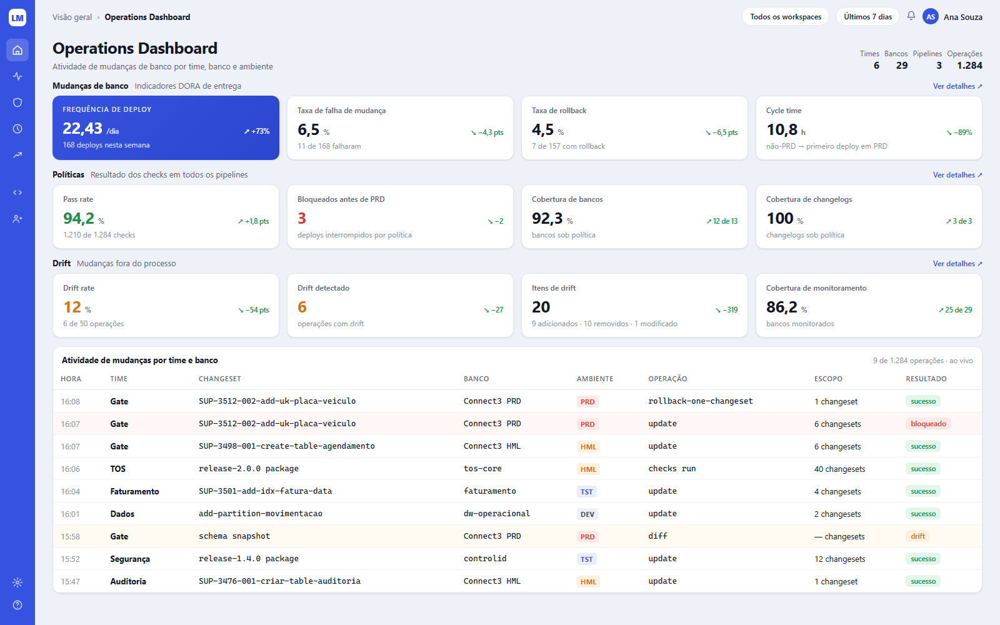
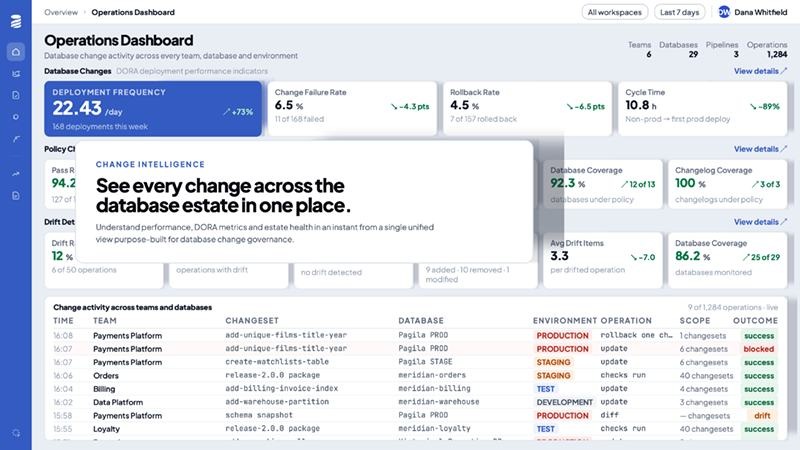

# Tela 01 — Operations Dashboard

| | |
|---|---|
| **Rota** | `/` |
| **Módulo** | Change Intelligence |
| **Requisitos** | RF-INT-01, RF-INT-04 |
| **Permissão** | `assignment:view` em ao menos um workspace |
| **API** | `GET /dashboard`, `GET /dashboard/activity`, SSE `GET /stream/operations` |
| **Mockup (fonte)** | [`mockups/01-operations-dashboard.html`](../mockups/01-operations-dashboard.html) |

## Print alvo

## Referência (Liquibase Secure)

## Objetivo

Visão única da atividade de mudanças em todos os times, bancos e ambientes: entrega (DORA), governança (políticas) e risco (drift).

## Layout

1. **Topbar:** breadcrumb `Visão geral › Operations Dashboard`; pills `Todos os workspaces ▾` e `Últimos 7 dias ▾` (7/30/90 dias).
2. **Cabeçalho:** h1 + subtítulo; à direita estatísticas `Times`, `Bancos`, `Pipelines`, `Operações` do período.
3. **Faixa "Mudanças de banco · Indicadores DORA de entrega"** + link `Ver detalhes ↗` (→ `/operations`). 4 KPIs, o primeiro hero.
4. **Faixa "Políticas · Resultado dos checks em todos os pipelines"** + `Ver detalhes ↗` (→ `/govern/enforcement`). 4 KPIs.
5. **Faixa "Drift · Mudanças fora do processo"** + `Ver detalhes ↗` (→ `/drift`). 4 KPIs.
6. **Tabela "Atividade de mudanças por time e banco"** com meta `N de TOTAL operações · ao vivo`.

## Fórmulas {#fórmulas}

Período P = filtro; P' = período anterior de mesmo tamanho. "Deploy" = operação `type=database-change`, `command ∈ {update, update-to-tag, update-count}` com `count_executed > 0` ou `status=FAILURE`; ou `command = flow` **com `count_executed > 0`** (o `flow` da CLI não traz changesets, os estágios são as operações, então não conta).

| KPI | Valor | Subtexto | Tendência (bom se) |
|-----|-------|----------|--------------------|
| Frequência de deploy (hero) | deploys(P) / dias(P), 2 casas, `/dia` | `N deploys nesta semana` | % vs P' (↑) |
| Taxa de falha de mudança | deploys com `FAILURE` / deploys | `X de N falharam` | Δ pts (↓) |
| Taxa de rollback | operações `rollback*` com sucesso / deploys com sucesso | `X de N com rollback` | Δ pts (↓) |
| Cycle time | mediana, por changeset aplicado em PRD no período, de (primeiro `deployed_at` em ambiente não-PRD → `deployed_at` em PRD), em horas | `não-PRD → primeiro deploy em PRD` | % (↓) |
| Pass rate | findings `PASSED` / total de avaliações de checks (`checks run`) | `X de N checks` | Δ pts (↑) |
| Bloqueados antes de PRD | operações `checks run` com `gate_result=BLOCKED` em ambiente `is_production` | `deploys interrompidos por política` | Δ abs (↓) |
| Cobertura de bancos | conexões com pacote de políticas efetivo / conexões ativas | `bancos sob política` | `X de Y` |
| Cobertura de changelogs | changelogs com pacote / changelogs | `changelogs sob política` | `X de Y` |
| Drift rate | `drift_run` com drift / `drift_run` concluídos | `X de N operações` | Δ pts (↓) |
| Drift detectado | nº `drift_run` com drift | `operações com drift` | Δ abs (↓) |
| Itens de drift | Σ added+removed+modified | `A adicionados · R removidos · M modificado(s)` | Δ abs (↓) |
| Cobertura de monitoramento | conexões com `drift_enabled` / conexões | `bancos monitorados` | `X de Y` |

Cores dos valores: Pass rate verde; Bloqueados vermelho; Drift rate/Drift detectado laranja; demais `--text`.

## Tabela de atividade

| Coluna | Fonte | Formato |
|--------|-------|---------|
| Hora | `operation.started_at` | `HH:mm` (`--text-3`) |
| Time | `project.team.name` | negrito |
| Projeto | `project.slug` | link → `/projects/:id` |
| Changeset | se 1 changeset → `changeset.cs_id`+descrição; se pacote → `<tag/label> package`; diff → `schema snapshot` | mono |
| Banco | `db_connection.display_name` | mono |
| Ambiente | `EnvBadge` | |
| Operação | `operation.command` | mono |
| Escopo | `count_executed + previously_run + failed` → `N changesets`; diff → `— changesets` | |
| Resultado | SUCCESS→`sucesso`, FAILURE→`falha`, BLOCKED→`bloqueado`, drift→`drift` | `StatusBadge` |

- O seletor **Projeto** no cabeçalho da tabela (`?project=<id>`, `GET /dashboard/activity?project=`) restringe só a tabela; os indicadores
  acima continuam do workspace inteiro. Com um changeset só, o nome leva a `/changesets/:id`; um pacote leva à operação.
- Mostra as 9 mais recentes; novas entram no topo via SSE com fade de 1 s.
- Linha com falha/bloqueio: fundo `#FFF6F6`; drift: `#FFFAF2`. Clique → `/operations/:id`.

## Estados

Carregando: skeleton de 12 cards + 9 linhas · Vazio: "Nenhuma operação no período — configure um coletor" · Erro por faixa (cada faixa carrega independente).

## Critérios de aceite

- [ ] Visual igual ao print alvo em 1600×1000 (diferença tolerada: fontes/anti-alias).
- [ ] Mudar período recalcula todos os KPIs e tendências.
- [ ] Nova operação ingerida aparece na tabela em < 5 s sem recarregar.
- [ ] KPIs batem com consulta SQL de conferência sobre a massa de teste (teste automatizado por fórmula).
- [ ] Usuário sem acesso a um workspace não tem seus dados somados.

## Estado da implementação (fase 1)

Entregue: o cabeçalho (times, bancos, pipelines, operações do período), a faixa **Mudanças de banco** com os quatro indicadores, o seletor de período (7/30/90 dias) e a tabela de atividade **ao vivo**, com o fade de 1 s para linhas novas e o indicador "ao vivo" / "sem conexão ao vivo".

Ainda **não existe**, de propósito:

- (E16) As faixas **Políticas** e **Drift** leem a tabela `metric_daily`, mantida por jobs (os 2 últimos dias a cada 10 minutos e a janela de
  90 dias toda noite); logo podem estar até 10 minutos atrás. Um KPI sem base de comparação aparece como `—`, nunca como 0. "Bloqueados antes de
  PRD" conta só gates que bloquearam em ambiente de produção. A cobertura trata um pacote `default` do workspace como cobrindo tudo.
  O cycle time continua calculado na hora (é uma mediana, não se soma por dia).
- O seletor **Todos os workspaces**: uma requisição sem o header `X-LQM-Workspace` cai no workspace `default`, nunca soma todos. Somar exige o RBAC (E11), para não misturar dados de quem não tem acesso.
- A tabela de métricas materializadas (`metric_daily`): os indicadores são calculados na hora, sobre o período — por isso o teto de 90 dias.

Detalhes que a fórmula da spec deixava em aberto:

- **Rollback rate**: rollbacks com sucesso ÷ deploys **com sucesso** (a falha não entra na base).
- **Cycle time**: só conta changesets cuja primeira execução fora de produção veio **antes** da execução em produção; um changeset que foi direto para PRD não tem cycle time.
- **Uma taxa sem denominador** (nenhum deploy no período) é **ausente**, não zero — a tela mostra "—". Zero diria "nada falhou", quando a verdade é "nada rodou".
- A tendência de **pontos percentuais** (falha, rollback) e a de **percentual** (frequência, cycle time) são grandezas diferentes e aparecem como tais (`+25,0 pts` × `+100,0%`).
- O `team` da tabela é o time do **projeto**; um projeto sem time mostra "—".
