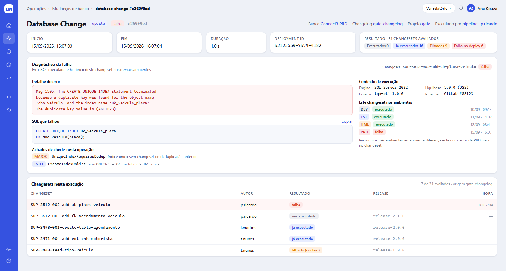
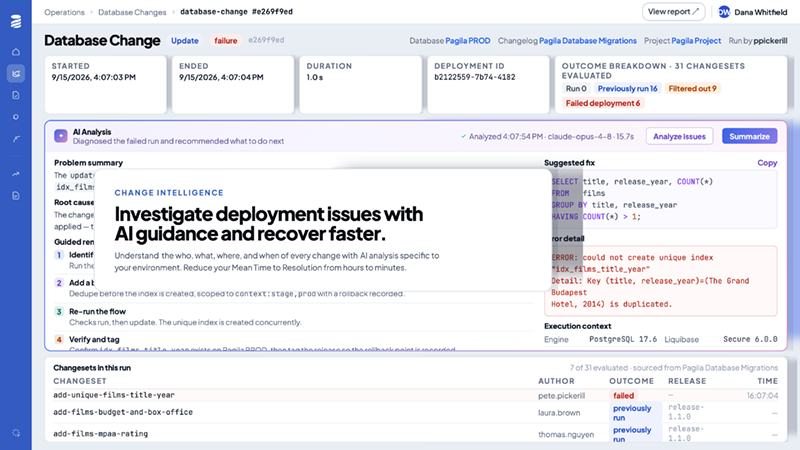

# Tela 02 — Database Change (detalhe da operação)

| | |
|---|---|
| **Rota** | `/operations/:id` |
| **Módulo** | Change Intelligence |
| **Requisitos** | RF-INT-03, RF-AUT-04 (RF-IA-01/02 são futuros e não entram nesta tela agora) |
| **Permissão** | `assignment:view` no projeto; rollback exige `rollback:<env>` |
| **API** | `GET /operations/{id}`, `/changesets`, `/log`, `/sql`, `/report`, `POST /rollback-requests` |
| **Mockup** | [`mockups/02-database-change.html`](../mockups/02-database-change.html) |

## Print alvo

## Referência

## Layout

1. **Topbar:** breadcrumb `Operações › Mudanças de banco › <type> #<id8>`; botão pill `Ver relatório ↗` (abre HTML/PDF).
2. **Cabeçalho:** h1 "Database Change" + `CommandChip` + `StatusBadge` + id curto (mono, `--text-3`).
   À direita, links: `Banco <conexão>`, `Changelog <nome>`, `Projeto <slug>`, `Executado por <source · usuário>`.
3. **Faixa de fatos (5 cards):** Início · Fim · Duração · Deployment ID · Resultado (`N changesets avaliados` + badges
   `Executados` neutral, `Já executados` info, `Filtrados` warning, `Falha no deploy` danger — badges com valor 0 ficam ocultos, exceto `Executados`).
4. **Painel "Diagnóstico da falha"** (só para `status=FAILURE|BLOCKED`; em `SUCCESS` não aparece):
   - Cabeçalho: título + subtítulo; à direita, o changeset que falhou (mono, link para o arquivo no Git no commit da operação).
   - Coluna esquerda: **Detalhe do erro** (CodeBlock variante erro, de `operation.error.message`) e
     **SQL que falhou** (CodeBlock SQL com `Copiar`, o statement gerado para o changeset com `outcome=FAILED`).
   - Coluna direita (420 px): **Contexto de execução** (Engine, Liquibase, Coletor, Pipeline com link para o job),
     **Este changeset nos ambientes** (`EnvBadge` + `StatusBadge` por ambiente, de `changeset_state` — mostra que
     passou em HML e falhou em PRD, que é o dado que explica a maioria das falhas) e **Achados de checks** desta
     operação, se houver (`SeverityBadge` + código do check, link para a tela 07).
5. **Tabela "Changesets nesta execução"** com meta `N de M avaliados · origem <changelog>`.
6. **Abas abaixo da tabela (não aparecem no print, rolagem):** `Log` (stream, busca, download) e `SQL` (SQL executado/gerado).
7. **Ações (menu ⋯ no cabeçalho):** `Rollback deste changeset`, `Rollback até a tag…`, `Copiar link`.

## Tabela de changesets

| Coluna | Fonte |
|--------|-------|
| Changeset | `changeset.cs_id` (+ descrição do arquivo) — mono |
| Autor | `changeset.author` |
| Resultado | `operation_changeset.outcome`: FAILED `falha` · NOT_EXECUTED `não executado` · PREVIOUSLY_RUN `já executado` · FILTERED `filtrado (<reason>)` · EXECUTED `executado` · ROLLED_BACK `rollback` |
| Release | label `release-*` do changeset, mono `--text-3` |
| Hora | `operation_changeset.started_at` ou `—` |

Ordenação: falhas primeiro, depois ordem de execução. Paginação 25.

## Diagnóstico da falha — origem dos dados

Nenhum campo deste painel é gerado; todos vêm do payload de ingestão e do modelo de dados.

| Bloco | Fonte |
|-------|-------|
| Detalhe do erro | `operation.error_message` (payload `error.message`) |
| SQL que falhou | `GET /operations/{id}/sql`, recortado no statement do changeset com `outcome=FAILED` |
| Contexto de execução | `operation.runtime` (engine, `dbVersion`, `liquibaseVersion`, `collector`) + `operation.ci` |
| Este changeset nos ambientes | `changeset_state` por `db_connection`, ordenado pela ordem do ambiente |
| Achados de checks | `policy_finding` da operação |
| Changeset que falhou | `operation_changeset` com `outcome=FAILED` + `changeset.file_path` no commit de `operation.git.commit` |

> **Análise por IA (D-13):** é feature futura e nasce desativada (`ai_enabled = false`). Enquanto estiver
> desligada — o caso das fases 0–3 — este painel é o diagnóstico da tela, e é o que deve ser implementado.
> Quando a IA for ligada, o `AiPanel` entra **acima** deste painel, sem substituí-lo: os dados brutos
> continuam sendo a base da investigação. Requisitos RF-IA-01/02 e contrato de resposta ficam em
> [02-requisitos-funcionais](../02-requisitos-funcionais.md) e [04-arquitetura](../04-arquitetura.md) § 4.5.

## Critérios de aceite

- [ ] Igual ao print alvo para uma operação com falha.
- [ ] Operação com `status=SUCCESS` não mostra o painel de diagnóstico.
- [ ] `Copiar` copia só o SQL do statement que falhou.
- [ ] Log de 2 MB carrega em streaming sem travar a página.
- [ ] Rollback em PRD cria solicitação pendente; não executa sem aprovação de outra pessoa.
- [ ] "Este changeset nos ambientes" reflete `changeset_state` e deixa evidente onde o changeset já passou.

## Estado da implementação: rollback (E17)

O rollback é **"voltar até um changeset"**: desfaz o escolhido e tudo o que foi aplicado depois dele no banco, do mais novo para o mais antigo (a ordem do
`rollbackCount` do Liquibase); um changeset do meio nunca é desfeito sozinho. Antes de pedir, o diálogo mostra a lista numerada (autor, data, destino, e o que não
tem rollback, que bloqueia o pedido). Pede-se em dois lugares: na aba **Rollback** do projeto (escolhe-se o banco, vê-se o que está aplicado e clica-se em *Voltar até aqui*)
e no painel **Rollbacks** do detalhe da operação (por changeset da operação ou até uma tag). Os dois mostram os pedidos com status, quem pediu, quem aprovou, a lista
que será desfeita, `Aprovar`, `Rejeitar` e `Cancelar` conforme o estado, e o link para a operação que o runner relatou. O menu `⋯` do cabeçalho e o rollback a partir
da matriz (tela 04) não existem.

A execução é do runner (`lqm runner`): ver docs/04, "Estado da implementação: rollback pela UI".

