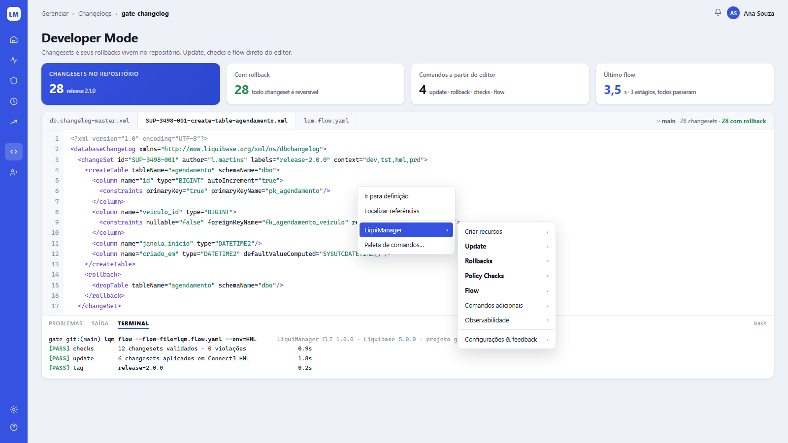
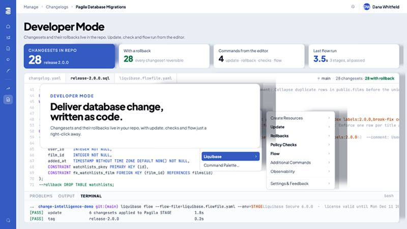

# Tela 03 — Developer Mode

| | |
|---|---|
| **Rota** | `/projects/:projectId/changelogs/:changelogId` |
| **Módulo** | Change Automation |
| **Requisitos** | RF-AUT-06, RF-AUT-03 |
| **Permissão** | `assignment:view` no projeto |
| **API** | `GET /projects/{id}/changelogs/{id}` (+ arquivos via GitLab API, pelo backend), `GET /operations?changelog=&command=flow&size=1` |
| **Mockup** | [`mockups/03-developer-mode.html`](../mockups/03-developer-mode.html) |

## Print alvo

## Referência

## Objetivo

Mostrar que changesets e rollbacks vivem no repositório e expor os comandos do LiquiManager onde o dev trabalha.
A tela web é a **vitrine somente leitura**; a execução acontece na **extensão IDE** (mesmo menu) e na CLI.

## Layout

1. Breadcrumb `Gerenciar › Changelogs › <changelog>`; h1 "Developer Mode" + subtítulo.
2. **KPIs:** `Changesets no repositório` (hero, `release X`), `Com rollback` (verde, "todo changeset é reversível" quando 100%,
   senão "N sem rollback" em laranja), `Comandos a partir do editor` (4 · update · rollback · checks · flow), `Último flow` (duração · N estágios, resultado).
3. **Editor (card):**
   - Abas de arquivos: master, arquivo selecionado, `lqm.flow.yaml`. À direita: `⑂ <branch> · N changesets · N com rollback`.
   - Monaco Editor somente leitura com realce XML/YAML/SQL; gutter de números.
   - Gutter decorations: ícone ✓ verde em changesets aplicados em PRD, ● azul pendentes, ✕ vermelho com falha (tooltip com ambiente).
   - **Menu de contexto** (botão direito, reproduzido no print aberto): `Ir para definição`, `Localizar referências`, —,
     `LiquiManager ›` (submenu: `Criar recursos`, **`Update`**, **`Rollbacks`**, **`Policy Checks`**, **`Flow`**, `Comandos adicionais`,
     `Observabilidade`, —, `Configurações & feedback`), `Paleta de comandos…`. Na web, itens que executam abrem modal com o comando CLI equivalente para copiar.
   - **Painel inferior:** abas `PROBLEMAS` (achados de checks do arquivo), `SAÍDA`, `TERMINAL` (saída do último flow — formato em [07 §2.1](../07-coletores-e-integracao.md#21-saída-padrão-exemplo-usado-no-print-da-tela-03)).

## Extensão IDE (fase 3)

- VS Code: comandos `lqm.update`, `lqm.rollback`, `lqm.checksRun`, `lqm.flow`, `lqm.status`; executa a CLI `lqm` no terminal integrado;
  diagnostics (sublinhado) a partir de `lqm checks run --format=json` ao salvar.
- Configuração: `lqm.url`, `lqm.project`, `lqm.defaultEnv` (DEV), token via `lqm login`.

## Critérios de aceite

- [ ] Igual ao print alvo com o menu de contexto aberto.
- [ ] Conteúdo do arquivo vem do commit da branch padrão (ou do commit de uma operação, via `?commit=`).
- [ ] Contagem "com rollback" bate com `changeset.has_rollback`.
- [ ] Aba PROBLEMAS lista achados com linha clicável.

## Estado da implementação (fase 3, E21)

Entregue em `/projects/:projectId/changelogs/:changelogId`; o item **Developer Mode** da barra lateral (`/developer`) abre a lista de
todos os changelogs para escolher um. API: `GET /projects/{id}/changelogs/{id}` (detalhe, KPIs, estado dos changesets, último flow,
achados) e `.../files?path=&commit=` (um arquivo do repositório, lido do GitLab pelo backend).

- **KPIs:** changesets no repositório (com a maior release), com rollback (laranja e "N sem rollback" quando falta, verde quando
  100%), comandos (fixo, 4) e último flow (duração, estágios e resultado). "Com rollback" vem de `changeset.has_rollback`.
- **Editor:** abas de arquivos (o master, cada arquivo que tem changeset e `lqm.flow.yaml`), números de linha, cores para XML, YAML e
  SQL, e na calha o estado **em produção** de cada changeset: `✓` aplicado, `●` pendente, `✕` falhou (glifo com texto alternativo e
  dica, nunca só cor). O menu de contexto (botão direito, ou o botão "Comandos do LiquiManager") tem `LiquiManager ›` com
  Update, Rollbacks, Policy Checks e Flow, que abrem o comando da CLI para copiar; as demais entradas aparecem desabilitadas
  ("Disponível na extensão do IDE").
- **Painel:** `PROBLEMAS` (achados da última operação que avaliou checks neste changelog, na linha do changeset; clicar leva à linha),
  `SAÍDA` (estado de cada changeset do arquivo) e `TERMINAL` (a saída do último flow, o mesmo texto da tela da operação).
- **Arquivos:** vêm do branch padrão, ou do commit de `?commit=`. O token de leitura é `lqm.gitlab.read-token` (configuração, nunca
  banco nem resposta); o projeto do GitLab sai da `repo_url` do projeto. Liquibase reporta o arquivo de um changeset relativo à raiz
  do changelog, que costuma ser `src/main/resources`: o backend tenta o caminho como veio e depois sob cada pasta acima do master.

Diferenças em relação à spec, de propósito:

- **Não é Monaco.** É um visualizador próprio (somente leitura) com o que a tela pede, sem uma dependência de vários megabytes. A
  contrapartida: não há busca dentro do arquivo, dobra de blocos nem minimapa.
- **O estado na calha é o de produção.** A spec fala de "aplicados em PRD", e a tela não escolhe outro ambiente. Com mais de uma
  conexão de produção, `FAILED` vence `EXECUTED`.
- **O comentário dos marcadores usa o estado do changeset**, não o do arquivo naquele commit: abrir um commit antigo (`?commit=`) mostra
  o texto antigo com o estado de hoje.
- **Sem a extensão do IDE** (E22, fora deste escopo): o menu só mostra o comando.
- **Leitura de arquivos testada contra um GitLab real** (POC em `deploy/gitlab-poc`, `connect-lqm.py verify`): usa
  `GET /api/v4/projects/:path/repository/files/:file/raw`. A lista de arquivos vem do que o LiquiManager já conhece (o master e os
  arquivos dos changesets ingeridos); um `includeAll` ou `include` não é expandido, então um changelog que ainda não teve operação
  ingerida mostra só o master.
