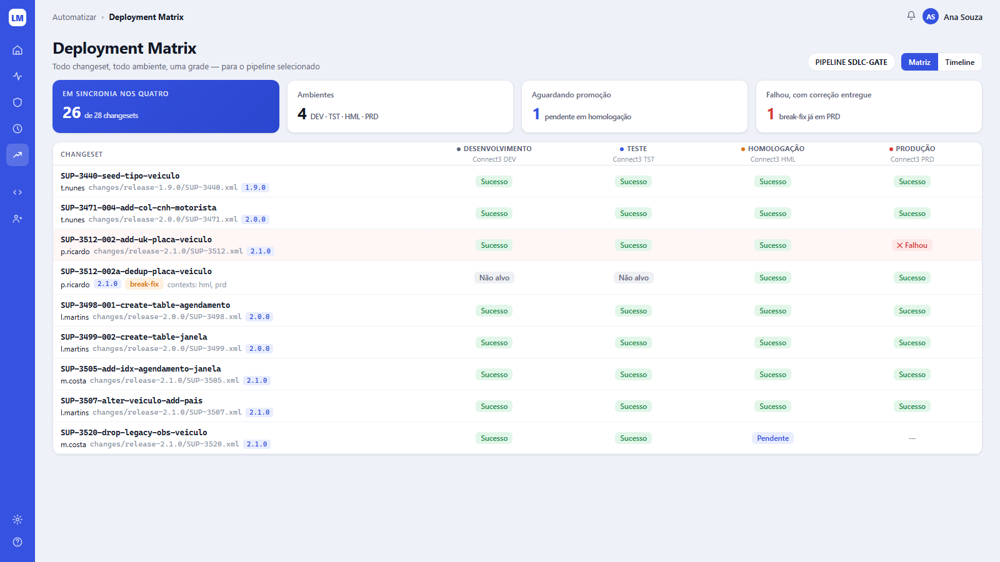
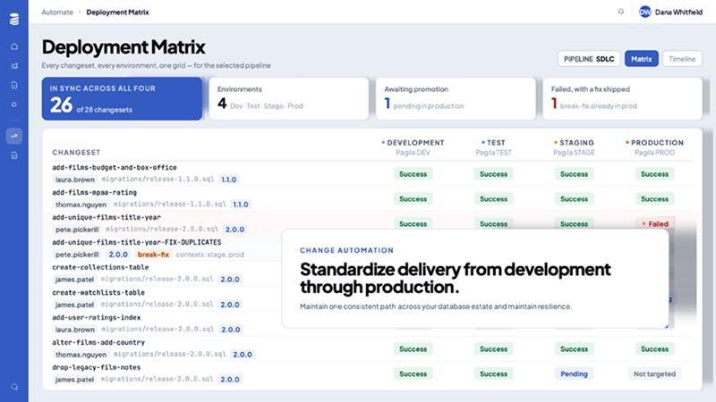

# Tela 04 — Deployment Matrix

| | |
|---|---|
| **Rota** | `/pipelines/:id/matrix` (e `/pipelines/:id/timeline`) |
| **Módulo** | Change Automation |
| **Requisitos** | RF-AUT-02, RF-AUT-05, RF-GOV-06 |
| **Permissão** | `assignment:view` no pipeline; promover exige `promote:<env>` |
| **API** | `GET /pipelines/{id}/matrix`, `GET /pipelines/{id}/timeline`, `POST /pipelines/{id}/stages/{stageId}/promote` |
| **Mockup** | [`mockups/04-deployment-matrix.html`](../mockups/04-deployment-matrix.html) |

## Print alvo



## Referência



## Layout

1. Breadcrumb `Automatizar › Deployment Matrix`; h1 + subtítulo "Todo changeset, todo ambiente, uma grade — para o pipeline selecionado".
2. À direita: pill `PIPELINE <nome> ▾` (seletor) e segmented `Matriz | Timeline`.
3. **KPIs:**
   - `Em sincronia nos <N por extenso>` (hero): changesets com status `Sucesso` ou `Não alvo` em **todos** os estágios / total — `26 de 28 changesets`.
   - `Ambientes`: nº de estágios + códigos (`DEV · TST · HML · PRD`).
   - `Aguardando promoção` (azul): changesets com alguma célula `Pendente` + texto `pendente em <ambiente mais avançado com pendência>`.
   - `Falhou, com correção entregue` (vermelho): changesets com `Falhou` em algum ambiente **e** um changeset `break-fix` posterior com `Sucesso` no mesmo ambiente.
4. **Tabela:** coluna `Changeset` + uma coluna por estágio (cabeçalho: ponto com a cor do ambiente, nome do ambiente em caixa alta, nome da conexão em `--text-3`).

## Linhas e células

- Linha: `cs_id` (mono, negrito) e abaixo `autor · caminho do arquivo (mono --text-3) · ReleaseTag` ; se `break-fix`, badge laranja `break-fix` + `contexts: …`.
- Ordem: ordem do changelog (ordem de execução esperada); filtro por release e busca.
- Célula (centralizada):

| Status | Badge | Regra |
|--------|-------|-------|
| Sucesso | success `Sucesso` | `changeset_state.status=EXECUTED` |
| Falhou | danger `✕ Falhou` | `FAILED` (linha inteira com fundo `#FFF6F6`) |
| Pendente | info `Pendente` | não aplicado, não filtrado, e o estágio anterior já tem `Sucesso` |
| Não alvo | neutral `Não alvo` | contexts/labels do changeset excluem o ambiente |
| — | texto `—` | ainda não chegou (estágio anterior também não aplicou) |
| Rollback | warning `Rollback` | `ROLLED_BACK` |
| Fora do processo | warning `Fora do processo` | `OUT_OF_PROCESS` (aplicado só detectado pelo scanner) |

- Hover na célula: tooltip com data, deployment id, executor. Clique → `/operations/:lastOperationId`.
- Menu ⋯ da célula (com permissão): `Promover para <próximo>`, `Rollback deste changeset`.

## Modo Timeline

Lista vertical agrupada por dia: cada evento "release X promovida para HML (6 changesets) por pipeline #88123". Filtros iguais.

## Critérios de aceite

- [ ] Igual ao print alvo para o pipeline de exemplo (massa de teste com os mesmos 9 changesets).
- [ ] Status de cada célula confere com `DATABASECHANGELOG` real do banco (teste de reconciliação com scanner).
- [ ] Changeset com context `hml,prd` mostra `Não alvo` em DEV/TST.
- [ ] Suporta 500 changesets × 6 ambientes com rolagem virtual sem travar.

## Estado da implementação (fase 1)

Entregue: o modo **Matriz** completo (grade, KPIs, busca, filtro por release, link da célula para a operação) e a derivação das células em `CellDerivation`, que é lógica pura e testada.

O que a spec pedia e **ainda não existe**, de propósito:

- **Rolagem virtual**: a grade pede no máximo 500 changesets por vez e desenha todos. Um pipeline maior vai precisar de virtualização.
- **O diálogo de promoção** mostra, antes do clique, quantos changesets o estágio anterior rodou e este ainda não, quais foram editados depois de
  rodar lá (o deploy os barra) e quais nenhum dos dois rodou (também barrados), com a mesma regra do D-22.
- **Executor na célula**: agora o tooltip traz o executor (`executedBy`, da operação que gerou a célula).
- **Menu ⋯ da célula**: a célula que rodou ganha um menu com `Ver operação` e `Pedir rollback` (os dois levam à tela da operação, onde o
  pedido de rollback é feito, E17); a célula `Pendente` ganha `Promover para <ambiente>` (abre o mesmo diálogo do cabeçalho da coluna, e só
  aparece com `promote:<ambiente>`).

Decisões que a spec não fechava, e que ficaram assim:

- **Ordem das linhas**: a ordem do changelog não é guardada em lugar nenhum, então as linhas seguem a ordem em que os changesets foram **vistos pela primeira vez** (`first_seen_at`) e depois o id.
- **Pendente × "—"**: só a **primeira** etapa ainda não aplicada é `Pendente` (é a próxima parada); as seguintes são `—` (`NOT_REACHED`). Uma etapa em que o changeset não é alvo (`Não alvo`) não trava a seguinte. Falha e rollback travam tudo que vem depois.
- **"Falhou, com correção entregue"**: pareia uma falha com qualquer changeset `break-fix` **posterior** do mesmo changelog que rodou com sucesso no mesmo banco. Nada nos dados liga uma correção à falha que ela responde, então isto é uma heurística.
- Os KPIs descrevem o conjunto **filtrado** (release e busca), como a grade.

## Changeset removido do changelog

O LiquiManager só aprendia os changesets por relatórios e os guardava para sempre: um arquivo apagado por um MR continuava "pendente" no diálogo de promoção e na
matriz. Agora todo relatório da CLI ou do starter diz se lista **o changelog inteiro** (`changelog.complete`: o coletor classificou todos os changesets antes do
comando). Um relatório completo **da branch principal do projeto** é uma foto do changelog, e o que o servidor conhece e a foto não tem fica marcado como removido
(`changeset.removed_at`); se voltar, a marca sai. Não valem: relatório de outra branch (o MR ainda não foi mergeado), de rollback (roda num commit antigo), de
coletor antigo (sem o campo) e relatório mais velho que o último usado.

**Só em MR.** Um relatório de outra branch (o `checks run` do pipeline de um MR) também registra os changesets daquela branch, e um changeset pode existir sem nunca ter
estado na principal (um arquivo renomeado ou acrescentado que ainda está em revisão). Cada changeset guarda **quando foi visto na branch principal**
(`seen_on_default_at`); o que só foi visto em outra branch é "só em MR !N" (ou "só na branch X"), com o título do MR, e **não faz parte do changelog**: fica fora da matriz,
dos KPIs, do diálogo de promoção e da aprovação, e nunca é marcado como removido (não saiu de lugar nenhum). O pipeline informa o MR em `ci.mergeRequestIid`,
`ci.mergeRequestTitle` e `ci.mergeRequestUrl` (GitLab: `CI_MERGE_REQUEST_*`); sem isso a tela diz só a branch. Quando o MR é mergeado, o primeiro relatório da principal o
traz para o changelog e esquece a origem. A aba Changesets do projeto lista esses changesets com o selo.

- **Matriz:** o removido some, a não ser que algum banco do pipeline ainda o tenha aplicado; aí aparece riscado, com o selo "removido do changelog", sem "próxima
  parada" (a célula do estágio seguinte é "—") e fora dos KPIs (o total é do que ainda está no changelog).
- **Diálogo de promoção:** o removido não conta como pendente nem barra o deploy; se o estágio anterior ainda o tem aplicado, o diálogo avisa ("não será promovido").
- **Aprovação de promoção** e **aba Changesets do projeto:** a primeira ignora os removidos; a segunda os mostra com o selo.

## Aba "Em revisão" do projeto

O que só um MR (ou branch) tem fica **fora** da aba Changesets e aparece na aba **Em revisão** do projeto, **agrupado por MR** (`/projects/:id?tab=review`; o número de grupos
abertos vai no título da aba). Cada grupo mostra o MR (com link), o título, a branch, quantos changesets, **quando foi o último relatório** e a lista (changeset, autor, arquivo,
release, se tem rollback). Nada some por tempo: o que tira um changeset daqui é o merge ou uma pessoa.

- **Merge:** o primeiro relatório da branch principal que lista o changeset o torna parte do changelog (`seen_on_default_at`), e ele deixa de ser "só em MR": o grupo some sozinho.
- **MR fechado:** com o **webhook do GitLab** registrado (docs/07, § 5.1: uma vez para o grupo ou a instância, não por projeto), o GitLab avisa e o grupo é encerrado sozinho, com a
  observação "Encerrado automaticamente: o MR !N foi fechado no GitLab por <quem>" (por `gitlab:<usuário>`); reabrir o MR reabre o grupo.
- **MR fechado antes de o pipeline reportar** (segundos depois de aberto): o estado do MR fica guardado, e o relatório que chega depois já nasce encerrado, com a observação "o MR !N já estava fechado no GitLab quando o pipeline reportou".
- **MR fechado sem webhook, ou deletado** (o GitLab não avisa a exclusão): quem tem `catalog:edit` **encerra o grupo à mão**, com uma **observação** de pelo menos 5 caracteres
  (`POST /projects/{id}/changesets/in-review/close`). Encerrar marca os changesets (quem, quando, por quê; fica na trilha de auditoria) e não apaga nada. Os encerrados ficam
  escondidos; "Mostrar encerrados" os traz de volta, com a observação, e **Reabrir** desfaz.
- **Voltou a reportar:** um relatório novo da branch de um grupo encerrado o reabre sozinho (a observação é descartada: o MR está vivo).
- Um changeset que algum banco já aplicou (`EXECUTED`) não é "em revisão": aparece na matriz e na aba Changesets, com o selo de origem.

## Estado da implementação (fase 3, E23)

**Modo Timeline** (`/pipelines/:id/timeline`, `GET /pipelines/{id}/timeline?from=&to=`): lista vertical agrupada por dia (o dia de
São Paulo, não o UTC). Cada evento é um **deploy** (operação `database-change` bem-sucedida que executou changesets numa conexão
do pipeline; a release é o primeiro label `release-*` entre eles) ou uma **promoção** pedida. Sem `from`/`to`, os últimos 30 dias,
no máximo 500 de cada tipo. O filtro de release vale; a busca por changeset não se aplica e some neste modo. O que o scanner viu
fora do processo aparece com a marca `Fora do processo`.

**Promover** (`POST /pipelines/{id}/stages/{stageId}/promote`, corpo opcional `{ "release": "release-2.1.0" }`): botão
`Promover para <ambiente>` no cabeçalho de cada coluna, exceto a primeira. Exige `promote:<env>` do ambiente do estágio (a
tela não esconde o botão: a API recusa com 403). Dispara o *pipeline trigger* do GitLab no `gitlabProjectId` e `gitlabTriggerRef`
do pipeline, com as variáveis `LQM_PROMOTE_TO`, `LQM_PROMOTE_STAGE`, `LQM_PROMOTE_BY` e, se houver, `LQM_PROMOTE_RELEASE`.
O job do `.gitlab-ci.yml` decide o que fazer com elas; por exemplo:

```yaml
promote:
  rules:
    - if: '$LQM_PROMOTE_TO'
  script:
    - lqm update --env "$LQM_PROMOTE_TO" --labels "$LQM_PROMOTE_RELEASE"
```

- **Configuração:** `lqm.gitlab.base-url` e `lqm.gitlab.trigger-token`. O token é um segredo de configuração, nunca coluna do banco
  nem resposta da API; o pipeline guarda só o projeto e o ref.
- A tabela `promotion` registra **que alguém pediu** e o que o GitLab respondeu (`TRIGGERED` ou `FAILED`). O que o job fez chega
  depois como operação comum, reportada pelo coletor de dentro dele. Recusa ou falta de rede do GitLab vira **502** `LQM-070`
  com o status HTTP e nada mais (o GitLab pode ecoar o token numa mensagem de erro).
- **Aprovação:** um estágio com "exige aprovação" (cadastro de Pipelines) **não dispara** o GitLab ao pedir: grava uma promoção
  `REQUESTED` (202) que aparece no painel "Promoções aguardando aprovação" da matriz. Outra pessoa com `promote:<env>` aprova (o que
  dispara o gatilho) ou rejeita; quem pediu **não** aprova o próprio pedido (SoD-2, `LQM-010`) e pode cancelá-lo. Só uma aprovação
  vale (a segunda recebe 409) e o disparo só acontece depois de a decisão estar gravada. Um estágio sem a marca promove na hora, como
  antes. Verificado ponta a ponta com Keycloak e GitLab reais: um usuário pediu, outro aprovou, o GitLab criou o pipeline.
  Não existe expiração do pedido nem aviso por e-mail/Teams de um pedido novo.
- **Gatilho testado contra um GitLab real** (POC em `deploy/gitlab-poc`, `connect-lqm.py verify`): o
  `POST /api/v4/projects/:id/trigger/pipeline` criou um pipeline com `LQM_PROMOTE_TO`, `LQM_PROMOTE_STAGE`, `LQM_PROMOTE_BY` e
  `LQM_PROMOTE_RELEASE` como enviados. O que o job do pipeline faz com essas variáveis é do `.gitlab-ci.yml` do projeto: o da POC
  não as usa.

