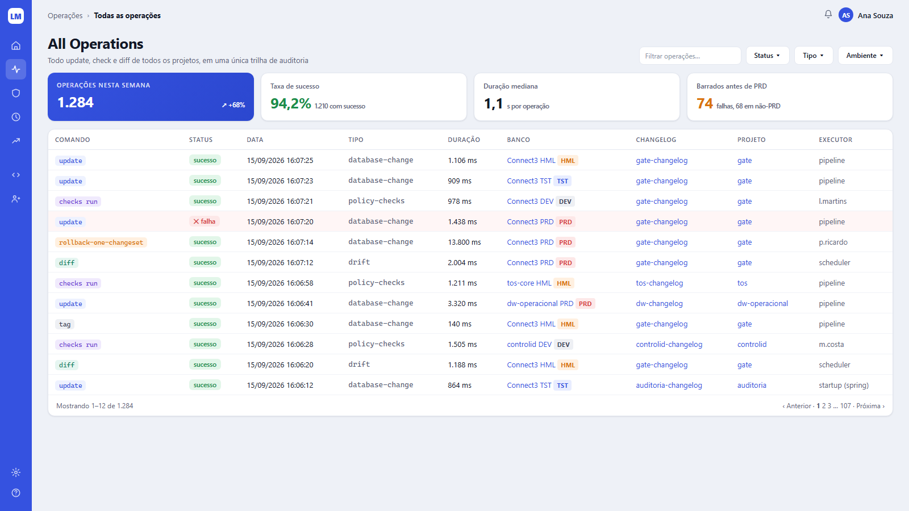
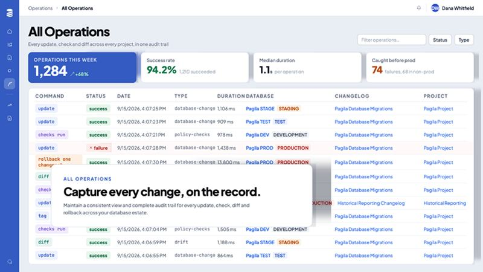

# Tela 05 — All Operations

| | |
|---|---|
| **Rota** | `/operations` (filtros na query string, ex.: `?status=FAILURE&env=PRD`) |
| **Módulo** | Change Automation |
| **Requisitos** | RF-AUT-01, RF-COL-05 |
| **Permissão** | `assignment:view` (linhas filtradas pelos escopos do usuário) |
| **API** | `GET /operations`, `GET /operations/kpis` |
| **Mockup** | [`mockups/05-all-operations.html`](../mockups/05-all-operations.html) |

## Print alvo

## Referência

## Layout

1. Breadcrumb `Operações › Todas as operações`; h1 "All Operations" + "Todo update, check e diff de todos os projetos, em uma única trilha de auditoria".
2. À direita: input `Filtrar operações…` (busca em changeset, banco, changelog, projeto, executor, id) e dropdowns `Status`, `Tipo`, `Ambiente`
   (mais filtros em "Mais ▾": comando, projeto, changelog, executor, origem, período).
3. **KPIs** (respeitam filtros): `Operações nesta semana` (hero, tendência %), `Taxa de sucesso` (verde, `N com sucesso`),
   `Duração mediana` (`s por operação`), `Barrados antes de PRD` (laranja: falhas+bloqueios em ambientes não-PRD; sub `N falhas, M em não-PRD`).
4. **Tabela** paginada server-side + rodapé `Mostrando 1–12 de 1.284` e paginação.

## Colunas

| Coluna | Fonte | Formato |
|--------|-------|---------|
| Comando | `command` | `CommandChip` |
| Status | `status` | `StatusBadge` (`✕ falha` com ícone) |
| Data | `started_at` | `dd/MM/yyyy HH:mm:ss` |
| Tipo | `type` | mono `--text-2` |
| Duração | `duration_ms` | `1.106 ms` / `13.800 ms` |
| Banco | conexão + `EnvBadge` | link → filtro por banco |
| Changeset | primeiro changeset da operação (`+N` quando há mais) | link → `/changesets/:id` |
| Changelog | `changelog.name` | link → `/projects/:id/changelogs/:id` |
| Projeto | `project.slug` | link → `/projects/:id` (os links navegam; o filtro fica nos controles de filtro) |
| Executor | `source` = pipeline → "pipeline"; startup → "startup (spring)"; scheduler; senão usuário | `--text-2` |

Ordenação por qualquer coluna (padrão Data desc). Linha com falha em fundo `#FFF6F6`. Clique → tela 02. Export CSV (até 50 mil linhas).

## Critérios de aceite

- [ ] Igual ao print alvo.
- [ ] Filtros refletem na URL (link compartilhável) e nos KPIs.
- [ ] 1 milhão de operações: primeira página < 1,5 s.
- [ ] Operação `observed` (scanner) aparece com executor "scanner" e badge `fora do processo`.
