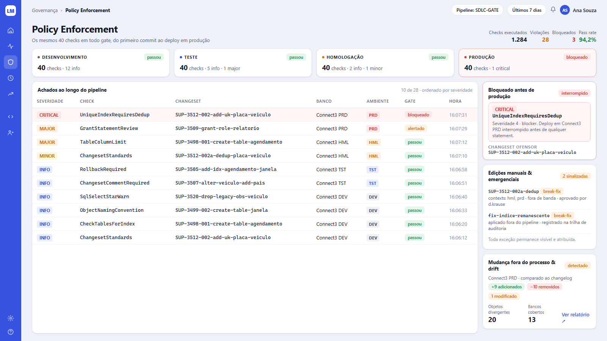
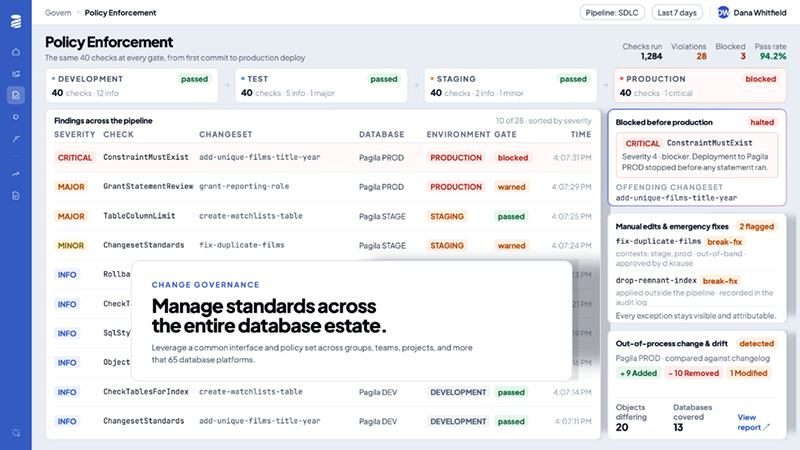

# Tela 06 — Policy Enforcement

| | |
|---|---|
| **Rota** | `/govern/enforcement?pipeline=&period=7d` |
| **Módulo** | Change Governance |
| **Requisitos** | RF-GOV-04, RF-GOV-05, RF-GOV-06, RF-GOV-07 |
| **Permissão** | `assignment:view`; solicitar exceção `exception:request`; aprovar `exception:approve` |
| **API** | `GET /enforcement`, `/policy-exceptions` |
| **Mockup** | [`mockups/06-policy-enforcement.html`](../mockups/06-policy-enforcement.html) |

## Print alvo

## Referência

## Layout

1. Breadcrumb `Governança › Policy Enforcement`; pills `Pipeline: <nome> ▾` e `Últimos 7 dias ▾`.
2. h1 + "Os mesmos N checks em todo gate, do primeiro commit ao deploy em produção" (N = checks no pacote).
   À direita: `Checks executados`, `Violações` (laranja = findings com sev ≥ 2), `Bloqueados` (vermelho), `Pass rate` (verde).
3. **Cards de gate (1 por estágio, com seta → entre eles):** ponto colorido + nome do ambiente em caixa alta; badge do resultado
   da **última** avaliação naquele estágio (`passou`/`alertado`/`bloqueado`); linha `<N> checks · <contagem por severidade>`.
   Card bloqueado: borda `#F3B4B4` e fundo `#FFF8F8`.
4. **Tabela "Achados ao longo do pipeline"** (`N de TOTAL · ordenado por severidade`): Severidade, Check (mono), Changeset (mono), Banco, Ambiente, Gate, Hora.
   Ordenação: severidade desc, depois hora desc. Linha CRITICAL bloqueada em `#FFF6F6`.
5. **Coluna lateral (300 px):**
   - **Bloqueado antes de produção** (borda vermelha, badge `interrompido`): alerta com `SeverityBadge` + check + explicação; `CHANGESET OFENSOR` + id.
     Botões (não no print, abaixo): `Solicitar exceção`, `Ver operação`.
   - **Edições manuais & emergenciais** (badge `N sinalizadas`): changesets `break-fix` e `OutOfProcessChange` com contexto e quem aprovou. Rodapé: "Toda exceção permanece visível e atribuída."
   - **Mudança fora do processo & drift** (badge `detectado`/`limpo`): conexão PRD do pipeline, badges `+N adicionados`, `−N removidos`, `N modificado(s)`,
     `Objetos divergentes`, `Bancos cobertos`, link `Ver relatório ↗` (→ tela 09 filtrada).

## Interações

- Clique em um achado → drawer com: mensagem completa, trecho do changeset com a linha destacada, check (link para tela 07), histórico do mesmo achado em outros ambientes, botão `Solicitar exceção` (modal: justificativa obrigatória ≥ 20 caracteres, prazo ≤ máximo do workspace).
- Exceção aprovada → achado continua listado com ícone de escudo e tooltip "Exceção até dd/MM por <aprovador>".

## Critérios de aceite

- [ ] Igual ao print alvo.
- [ ] Um `update` em PRD com finding sev 4 sem exceção é recusado pelo starter/CLI e aparece aqui como `bloqueado` em < 5 s.
- [ ] Autor do changeset não consegue aprovar a própria exceção (botão desabilitado + API `LQM-010`).
- [ ] Exceção vencida volta a bloquear na próxima execução.

## Estado da implementação (E5 + E10)

Implementado: seletor de pipeline e período, os quatro números, os cards de gate por estágio (último veredito e
achados por severidade), a tabela de achados (clique abre a operação), o painel "Bloqueado antes de produção" com
**Solicitar exceção**, o painel de **exceções governadas** (aprovar, rejeitar, revogar) e o de **edições emergenciais**
(changesets `break-fix` aplicados no período).

Diferenças em relação ao print alvo, e por quê:

- **"Checks executados" virou "Avaliações".** Só os achados são persistidos, não cada check que passou; o número de
  checks executados não existe nos dados. Avaliações = operações que passaram por um gate; Pass rate = parte delas
  que passou limpa. Sem avaliações o Pass rate aparece como `—`, não como 0%.
- O painel de **mudança fora do processo e drift** depende do scanner e do drift (E14/E15) e mostra um aviso.
- O **drawer do achado** (trecho do changeset, histórico em outros ambientes) não existe; o clique leva à operação.
- "Quem aprovou" um break-fix não aparece: o rótulo `break-fix` não carrega a exceção que o autorizou.
- O prazo máximo de uma exceção é `lqm.exceptions.max-days` (30), uma propriedade, até a tela de configurações existir.

**Exceções (E10), regras no servidor:** a justificativa tem ≥ 20 caracteres; o prazo é obrigatório e limitado; quem
solicita não aprova (SoD-2) e o autor do changeset não aprova exceção para ele (SoD-1), ambos `LQM-010`; uma exceção
vencida não se aprova (`LQM-030`) e deixa de ser entregue aos coletores sozinha, sem job. Em desenvolvimento, sem
Keycloak, tudo roda como o usuário `dev`; para exercitar a segregação use `localStorage.setItem('lqm.devUser', 'ana')`
no navegador (cabeçalho `X-LQM-User`, só aceito quando nenhum emissor OIDC está configurado).

API: `GET /enforcement?pipeline=&period=`, `/policy-exceptions` e `/{id}/approve|reject|revoke`.
