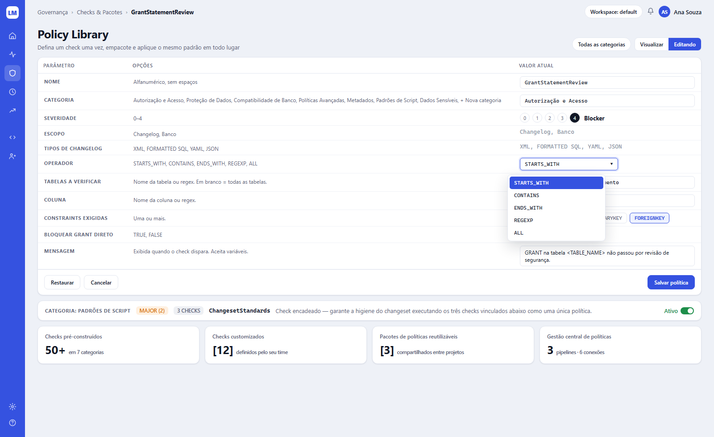
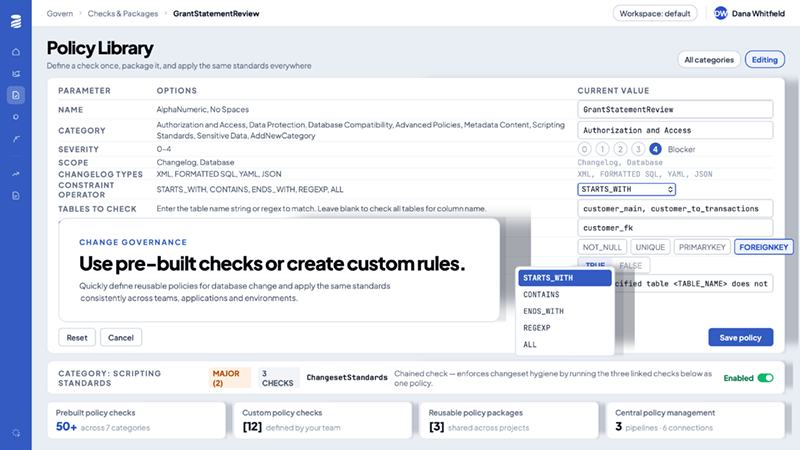

# Tela 07 — Policy Library

| | |
|---|---|
| **Rota** | `/govern/checks` (lista) e `/govern/checks/:id` (edição — print) |
| **Módulo** | Change Governance |
| **Requisitos** | RF-GOV-01, RF-GOV-02, RF-GOV-03 |
| **Permissão** | `assignment:view`; editar `policy:edit` |
| **API** | `GET/PUT /policy-checks/{id}`, `POST /policy-checks/{id}/copy`, `POST /policy-checks/{id}/test`, `GET /policy-checks/summary`, `/policy-packages` |
| **Mockup** | [`mockups/07-policy-library.html`](../mockups/07-policy-library.html) |

## Print alvo

## Referência

## Layout (edição de um check)

1. Breadcrumb `Governança › Checks & Pacotes › <code>`; pill `Workspace: <slug>`.
2. h1 "Policy Library" + "Defina um check uma vez, empacote e aplique o mesmo padrão em todo lugar".
   À direita: pill `Todas as categorias ▾` e segmented `Visualizar | Editando` (Editando só com `policy:edit`).
3. **Formulário em tabela** de 3 colunas: `PARÂMETRO` (rótulo caixa alta), `OPÇÕES` (texto de ajuda / valores aceitos), `VALOR ATUAL` (controle, 420 px).
   Linhas geradas dinamicamente a partir do `parameters_schema` (JSON Schema) do check:

| Parâmetro | Controle | Regra |
|-----------|----------|-------|
| Nome | input mono | `^[A-Za-z0-9]+$`, único no workspace |
| Categoria | select (+ "Nova categoria") | 7 padrão |
| Severidade | 5 botões circulares 0–4 + rótulo (`Info`, `Minor`, `Major`, `Critical`, `Blocker`) | selecionado = preenchido escuro |
| Escopo | leitura (mono `--text-3`) | definido pelo kind |
| Tipos de changelog | leitura | |
| Operador | select mono `STARTS_WITH, CONTAINS, ENDS_WITH, REGEXP, ALL` (print com dropdown aberto) | |
| Tabelas a verificar | input mono (lista por vírgula ou regex) | vazio = todas |
| Coluna | input mono | |
| Constraints exigidas | chips multi-seleção `NOT_NULL UNIQUE PRIMARYKEY FOREIGNKEY` | selecionado = borda/fundo primário |
| Bloquear GRANT direto | chips `TRUE FALSE` | |
| Mensagem | textarea | variáveis `<TABLE_NAME>` etc. |

4. Rodapé do card: `Restaurar` (volta ao padrão do builtin), `Cancelar`, `Salvar política` (primário, à direita).
   Ao lado (fora do print): `Testar` → modal para colar um changeset e ver os achados (dry-run).
5. **Barra de check encadeado/pacote** (card horizontal): `CATEGORIA: <nome>`, badge severidade (`MAJOR (2)`), `N CHECKS`, nome mono, descrição, toggle `Ativo`.
6. **KPIs de rodapé:** `Checks pré-construídos` (`50+ em 7 categorias`), `Checks customizados` (`[N] definidos pelo seu time`),
   `Pacotes de políticas reutilizáveis` (`[N] compartilhados entre projetos`), `Gestão central de políticas` (`N pipelines · M conexões`).

## Lista (`/govern/checks`, não está no print)

Tabela: Código, Categoria, Kind, Severidade, Ativo, Usado em (pacotes), Atualizado por/em. Filtros por categoria/kind/ativo. Botão `Novo check`.
Aba `Pacotes`: nome, nº checks, limiares, atribuído a (projetos/estágios).

## Critérios de aceite

- [ ] Igual ao print alvo (com o dropdown de Operador aberto).
- [ ] Builtin não pode ser excluído; "Salvar" em builtin cria cópia customizada se o parâmetro alterado não for permitido no builtin.
- [ ] Salvar gera `audit_event policy.update` com before/after.
- [ ] Dry-run retorna o mesmo resultado que `lqm checks run` para o mesmo changeset.

## Estado da implementação (E5 + E9)

Lista, filtros e os quatro números do rodapé (`GET /policy-checks`, `/summary`). A coluna **Motor** diz se o check tem
código por trás: o catálogo lista 51 configuráveis e **os 51 são implementados** (os 4 de processo o sistema levanta sozinho, e a
coluna os mostra como não implementados no motor); um check listado e não implementado não protege nada, e a tela não pode sugerir
o contrário.

**Edição (E9):** `/govern/checks/new` e `/govern/checks/:id` — a tabela Parâmetro / Opções / Valor atual, gerada pelo tipo
do check (REGEX, SQL_PATTERN, SPEL, CHAINED). Builtin abre só para leitura, com `Copiar para customizar`. `Testar` abre o
dry-run, que usa os valores do formulário mesmo sem salvar. `Excluir` é recusado se o check está em um pacote.
`/govern/packages` lista e edita pacotes (limiares e checks, com severidade própria por pacote).

Diferenças do print alvo: o campo **Nome** é o código; "Restaurar" não existe (a cópia é a forma de customizar, e o
builtin nunca muda); o seletor "Visualizar | Editando" é um indicador, não um botão, porque sem RBAC (E11) não há quem
distinguir. A atribuição de pacote a changelog e a estágio se faz na tela do projeto (aba Changelogs) e na de pipelines (linha do estágio), pela API `/policy-packages/{id}/assign`.
