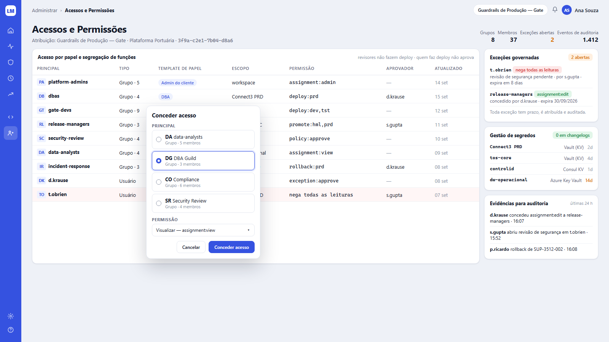
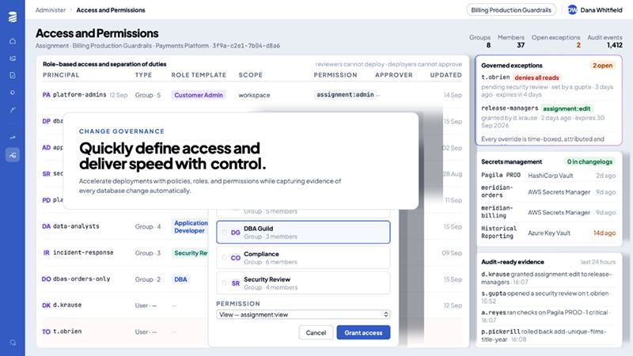

# Tela 08 — Acessos e Permissões

| | |
|---|---|
| **Rota** | `/admin/access?assignment=<id>` |
| **Módulo** | Change Governance / Administração |
| **Requisitos** | RF-ADM-02, RF-ADM-04, RF-ADM-05, RF-GOV-05 |
| **Permissão** | `assignment:view` para ver; `assignment:admin` no escopo para conceder/revogar |
| **API** | `GET/POST/DELETE /access/bindings`, `GET /principals`, `GET /secrets/status`, `GET /audit`, `/policy-exceptions` |
| **Mockup** | [`mockups/08-access-permissions.html`](../mockups/08-access-permissions.html) |

## Print alvo

## Referência

## Conceito: "Atribuição" (assignment)

Um conjunto nomeado de bindings aplicado a um escopo (ex.: **Guardrails de Produção — Gate** = regras de acesso para
o pipeline `SDLC-GATE` em PRD). O pill no topo troca a atribuição; o subtítulo mostra `Atribuição: <nome> · <área> · <id curto>`.

## Layout

1. Breadcrumb `Administrar › Acessos e Permissões`; pill da atribuição.
2. h1 + subtítulo; à direita `Grupos`, `Membros`, `Exceções abertas` (laranja), `Eventos de auditoria`.
3. **Tabela "Acesso por papel e segregação de funções"**, meta à direita com as regras SoD ativas
   ("revisores não fazem deploy · quem faz deploy não aprova").
   Colunas: Principal (avatar com iniciais + nome), Tipo (`Grupo · N` / `Usuário`), Template de papel (`chip`), Escopo,
   Permissão (mono), Aprovador, Atualizado. Linha com negação em `#FFF6F6`.
4. **Modal "Conceder acesso"** (print aberto): lista de principais em cards com radio (busca no topo quando > 6),
   `PERMISSÃO` select (`Visualizar — assignment:view`, `Editar — assignment:edit`, …), campo `Expira em` obrigatório quando escopo PRD,
   botões `Cancelar` / `Conceder acesso`. Violação de SoD → aviso inline vermelho e botão desabilitado.
5. **Lateral:**
   - **Exceções governadas** (`N abertas`): principal/grupo, badge da permissão (vermelho p/ negação, verde p/ concessão), quem concedeu, expiração.
     Rodapé "Toda exceção tem prazo, é atribuída e auditada."
   - **Gestão de segredos** (`N em changelogs` — verde se 0): conexão (mono), provedor, idade da rotação (laranja ≥ 14 d, vermelho ≥ 30 d).
   - **Evidências para auditoria** (`últimas 24 h`): últimos eventos em linguagem natural; link `Exportar` (`audit:export`).

## Critérios de aceite

- [ ] Igual ao print alvo com o modal aberto.
- [ ] Conceder `deploy:prd` a quem já tem `exception:approve` no mesmo escopo é bloqueado (`LQM-010`).
- [ ] Toda concessão/revogação aparece em "Evidências" imediatamente.
- [ ] Valor de segredo nunca trafega para o frontend.

## Estado da implementação (E11)

Implementado em `/admin/access`: os quatro contadores, a tabela de acessos (principal, tipo, papel, escopo, permissões efetivas
com as negações em destaque, aprovador, prazo, revogar), o modal **Conceder acesso** com busca e cadastro de principal,
papéis, permissões avulsas e negações, escopo WORKSPACE/PROJECT/ENVIRONMENT, e o aviso inline de SoD-3/SoD-4 que desabilita o botão.
O painel de **exceções governadas** é o mesmo da tela 06.

Também implementados: **Gestão de segredos** (conexão, provedor, idade da rotação em verde/laranja/vermelho, "N em changelogs") e
**Evidências para auditoria** (últimos eventos em linguagem natural, verificação da cadeia de hashes, `Exportar` em CSV). Fora do print:
o seletor de "atribuição" (conjunto nomeado de bindings) não existe: a tabela mostra todos os bindings do workspace.
Os escopos CONNECTION e PIPELINE existem na API, não no modal.

