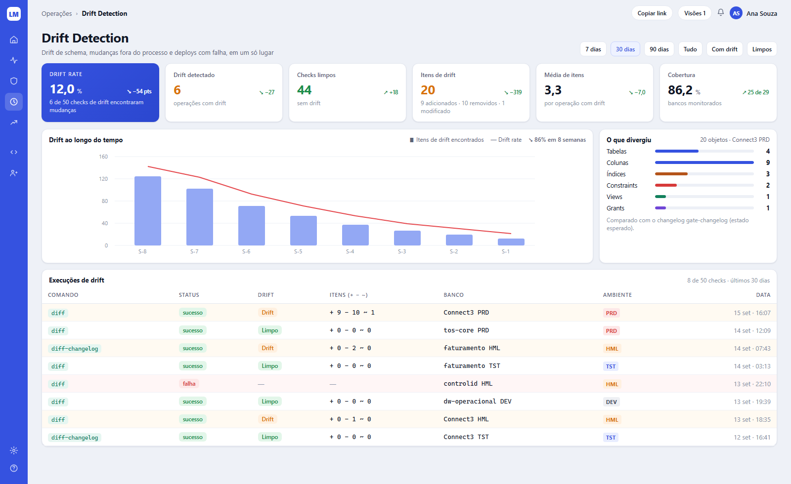
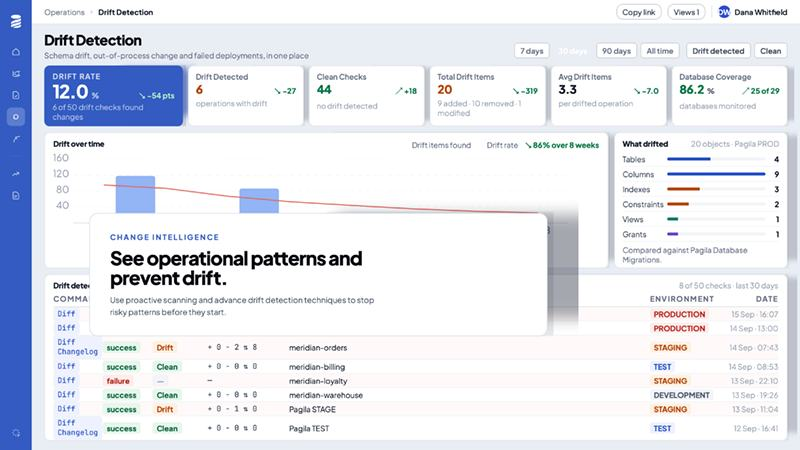

# Tela 09 — Drift Detection

| | |
|---|---|
| **Rota** | `/drift?period=30d&filter=all&connection=` |
| **Módulo** | Change Intelligence |
| **Requisitos** | RF-INT-02, RF-COL-04, RF-GOV-07 |
| **Permissão** | `assignment:view`; rodar `drift:run`; aceitar item `drift:accept` |
| **API** | `GET /drift/summary`, `GET /drift/runs`, `/drift/runs/{id}/items`, `POST /connections/{id}/drift-runs`, `POST /drift/items/{id}/accept`, `POST /drift/runs/{id}/changelog` |
| **Mockup** | [`mockups/09-drift-detection.html`](../mockups/09-drift-detection.html) |

## Print alvo

## Referência

## Layout

1. Breadcrumb `Operações › Drift Detection`; pills `Copiar link` e `Visões N` (visões salvas de filtros).
2. h1 + "Drift de schema, mudanças fora do processo e deploys com falha, em um só lugar".
   À direita, filtros em botões: `7 dias`, `30 dias` (selecionado), `90 dias`, `Tudo`, `Com drift`, `Limpos`.
3. **6 KPIs** (grade de 6): `Drift rate` (hero), `Drift detectado` (laranja), `Checks limpos` (verde), `Itens de drift` (laranja, sub com +/−/~),
   `Média de itens` (por operação com drift), `Cobertura` (bancos monitorados). Fórmulas iguais às da tela 01.
4. **Gráfico "Drift ao longo do tempo"** (Recharts `ComposedChart`): barras semanais = itens encontrados (cor `#93A8F4`),
   linha = drift rate % (cor `#E5484D`, eixo secundário); legenda à direita + tendência `↘ 86% em 8 semanas`. Eixo X `S-8 … S-1`.
5. **"O que divergiu"** (360 px): barras horizontais por tipo de objeto (Tabelas, Colunas, Índices, Constraints, Views, Grants…)
   com cores distintas e contagem; cabeçalho `N objetos · <conexão>` (conexão selecionada ou a com mais drift); rodapé "Comparado com o changelog <nome> (estado esperado)".
6. **Tabela "Execuções de drift"** (`N de M checks · últimos 30 dias`): Comando (`diff`/`diff-changelog`), Status, Drift (`Drift`/`Limpo`/`—`),
   Itens (`+ a − r ~ m` mono), Banco, Ambiente, Data (`15 set · 16:07`, à direita). Linha com drift em `#FFFAF2`, falha em `#FFF6F6`.

## Detalhe de uma execução (drawer ao clicar na linha)

- Itens agrupados por tipo: `ADDED` verde, `REMOVED` vermelho, `MODIFIED` laranja; para MODIFIED mostra antes/depois (ex.: tipo de coluna).
- Ações: `Aceitar item` (justificativa), `Gerar changelog do drift` (baixa XML gerado por `diff-changelog` para virar changeset no repositório),
  `Abrir operação`, `Rodar novamente`.

## Critérios de aceite

- [ ] Igual ao print alvo.
- [ ] Criar uma coluna manualmente via SSMS em HML → próxima execução agendada mostra `+1` em Colunas.
- [ ] Item aceito não reaparece nas próximas execuções enquanto o objeto não mudar.
- [ ] `diff-changelog` gerado aplica sem erro num banco limpo e elimina o drift.

## Estado da implementação (E14)

Implementado: os 6 KPIs, o gráfico semanal (barras de itens e linha de drift rate, 8 semanas, com a tendência), "O que divergiu" por tipo
de objeto, a tabela de execuções e o drawer da execução (itens por tipo, antes/depois, aceitar com justificativa, gerar changelog,
abrir operação, rodar novamente, tomar o estado atual como limpo).

Como funciona (D-06, último snapshot limpo): a **referência é tirada logo depois de cada update bem-sucedido** (o evento da ingestão
dispara um snapshot assíncrono nas conexões com drift ligado; `scanner` nunca atualiza a referência, porque o que ele vê é justamente
o drift). A primeira execução numa conexão só estabelece a referência. Uma execução é também uma operação do tipo `drift`.
Item aceito é carregado para as execuções seguintes enquanto o objeto estiver **exatamente** igual (a definição do objeto
faz parte da identidade do item); se mudar de novo, volta.

O `diff-changelog` gerado **adota** o drift: aplicado a um banco no estado limpo, leva-o ao estado divergido (verificado em teste contra
um schema real). Não é a correção que desfaz o drift.

**SQL Server:** exercitado contra um SQL Server 2022 real (coluna adicionada e alterada, índice e tabela novos, sem falso positivo num banco
limpo). A conta precisa de `VIEW DEFINITION`: sem ela o banco esconde valores padrão e definições de views e o drift acusaria mudanças
inexistentes, então a execução **falha** com o motivo (detalhes em docs/07 § 4.1).

**Vários schemas e grants.** O campo de schema da conexão aceita uma lista (`dbo, audit`): cada schema é comparado com ele mesmo e, havendo mais de um, todo nome leva o schema (`COLUMN audit.cliente.email`); o primeiro schema guarda o `DATABASECHANGELOG`.
Os **grants** (privilégios em tabelas e views) são lidos do catálogo e comparados como uma lista: um grant dado ou retirado por fora vira um item `GRANT` (`papel on schema.objeto`, com o privilégio nos detalhes); o grant de uma tabela que nasceu ou sumiu junto não é notícia extra. Só **PostgreSQL** lê grants hoje (de `pg_class.relacl`, que qualquer login enxerga); nos outros bancos o drift não diz nada sobre eles em vez de adivinhar, e uma referência anterior a esta função só passa a comparar grants na próxima referência. O `diff-changelog` não gera nada para itens `GRANT`.

Limites: privilégios de coluna e de schema não são lidos; "Copiar link" copia o endereço (os filtros vivem na URL) e "Visões" guarda filtros nomeados **neste navegador** (`localStorage`: não acompanham a pessoa para outro);
o cron por conexão é lido do banco a cada minuto (resolução de 1 minuto); o gráfico mostra a taxa por semana ISO em UTC.

