# LiquiManager — instalação em Kubernetes (Helm)

O LiquiManager é um control plane de mudanças de banco sobre **Liquibase OSS**: ele não substitui o Liquibase, observa, governa e dá
visibilidade às mudanças que o `liquibase-core` executa (histórico, políticas antes do deploy, drift, promoção entre ambientes e rollback
pela interface).

Este diretório (`helm/`) traz o **Helm chart de produção** do LiquiManager e o guia de instalação. As imagens estão publicadas no Docker Hub
(`carloslimadocker/lqm-api`, `lqm-web` e `lqm-cli`), então **não é preciso compilar nada**. Os comandos abaixo são executados **a partir da raiz do repositório**.

| Caminho | O quê |
|---------|-------|
| `helm/liquimanager/` | O chart (API, web, worker opcional, runner de rollback opcional) |
| `helm/values-producao.example.yaml` | Ponto de partida: copie, ajuste e instale |
| `lqm-api/` `lqm-web/` `lqm-cli/` | Os três módulos que viram imagem (cada um tem o seu `Dockerfile`) |
| `lqm-policy-engine/` `lqm-core-client/` `lqm-collector/` `lqm-spring-boot-starter/` `lqm-worker/` | Bibliotecas e módulos usados pelos anteriores |
| `contracts/openapi.yaml` | Contrato da API |
| `deploy/` | Ambiente local com Docker Compose, Keycloak, GitLab de teste e exemplos de runner |
| `helm/screenshots/` | Os prints usados neste guia |

## Como as peças se encaixam

```
 navegador ──► Ingress ──► web (Nginx) ──/api──► API (Spring Boot) ──► PostgreSQL
                                                   │  ▲
                              logs e relatórios ◄──┘  └── tokens de serviço ── CLI `lqm` na esteira / starter no serviço
                              (PVC ou S3)                  runner de rollback ── busca o trabalho na API
```

- **web** serve a interface e repassa `/api` para a API (inclusive o feed ao vivo, SSE). O navegador fala com **um endereço só**.
- **API** aplica o próprio schema no PostgreSQL ao subir (Liquibase, contexto `seed`: workspace, ambientes, papéis e o catálogo de checks).
- **jobs** (drift, métricas, scanner, notificações) rodam dentro da API por padrão; com `worker.enabled=true` vão para um deployment próprio.
- **runner** (opcional) busca no LiquiManager os rollbacks aprovados e os executa nos bancos alvo. A API nunca recebe a credencial desses bancos.

## Pré-requisitos

- Kubernetes 1.25 ou mais novo, `kubectl` e **Helm 3**.
- **Kubernetes 1.25+** e **Helm 3**.
- Um **PostgreSQL 14+** para o banco do próprio LiquiManager (gerenciado, de preferência; o chart não sobe banco).
- Um provedor **OIDC** (por exemplo Keycloak). O login é obrigatório: o chart recusa instalar sem ele.
- Para um ambiente real: um provedor OIDC (por exemplo Keycloak) e, se houver mais de uma réplica da API, um armazenamento S3.

## 1. Imagens

O chart usa por padrão as imagens públicas do Docker Hub, na tag igual ao `appVersion` do chart (`1.1.0`):

| Imagem | Para quê |
|--------|----------|
| `carloslimadocker/lqm-api` | API (e o worker, quando `worker.enabled=true`) |
| `carloslimadocker/lqm-web` | Interface (Nginx) |
| `carloslimadocker/lqm-cli` | Comando `lqm` na esteira e o runner de rollback (só com `runner.enabled=true`) |

Para usar um espelho ou compilar as suas, o contexto de build é a **raiz deste repositório**:

```bash
docker build -f lqm-api/Dockerfile -t meu-registry/lqm-api:1.1.0 .
docker build -f lqm-web/Dockerfile -t meu-registry/lqm-web:1.1.0 .
docker build -f lqm-cli/Dockerfile -t meu-registry/lqm-cli:1.1.0 .
```

e aponte `images.registry` para `meu-registry` (e `images.pullSecrets`, se for privado). Mude as tags com `api.image.tag`, `web.image.tag` e `runner.image.tag`.

## 2. Instalação

### 2.0 Pelo repositório do chart (sem clonar)

O chart é publicado como **OCI** no Docker Hub. Com o Helm 3.8+:

```bash
helm install lqm oci://registry-1.docker.io/carloslimadocker/liquimanager --version 0.2.0 -n lqm --create-namespace -f values-producao.yaml
```

Para ver os valores padrão e o exemplo de produção sem clonar o repositório:

```bash
helm show values oci://registry-1.docker.io/carloslimadocker/liquimanager --version 0.2.0
```

Os passos 2.1 a 2.3 abaixo valem do mesmo jeito; só troque `./helm/liquimanager` por `oci://registry-1.docker.io/carloslimadocker/liquimanager --version 0.2.0`.

### 2.1 Crie os Secrets (nenhuma senha vai para o `values`)

```bash
kubectl create namespace lqm
```

```bash
# banco do LiquiManager
kubectl -n lqm create secret generic lqm-db \
  --from-literal=username=lqm --from-literal=password='<senha>'
```

```bash
# armazenamento S3 (obrigatório com mais de uma réplica da API)
kubectl -n lqm create secret generic lqm-s3 \
  --from-literal=accessKey='<chave>' --from-literal=secretKey='<segredo>'
```

```bash
# só se os repositórios no Docker Hub forem privados (os públicos não precisam)
kubectl -n lqm create secret docker-registry registry-credentials \
  --docker-server=https://index.docker.io/v1/ --docker-username=carloslimadocker --docker-password='<token do Docker Hub>'
```

Outros Secrets só se você usar a integração correspondente: `lqm-vault` (chaves `token`, ou `roleId` e `secretId`), `lqm-gitlab`
(`readToken` e `triggerToken`), `lqm-runner` (`token`), `lqm-runner-git` (`url`) e `lqm-runner-db` (`username` e `password`).

### 2.2 Valores

```bash
cp helm/values-producao.example.yaml values-producao.yaml
```

Edite o que tem `exemplo.com` ou `<...>`: `database.url`, `oidc.issuerUri`, `oidc.bootstrapAdmins`, `publicUrl`,
`ingress.host`, `storage.s3.endpoint`. **Não versione esse arquivo com segredos.**

### 2.3 Instale

```bash
helm install lqm ./helm/liquimanager -n lqm -f values-producao.yaml
kubectl -n lqm rollout status deploy/lqm-liquimanager-api
```

A primeira subida demora: a API cria o schema. O `startupProbe` espera até 5 minutos antes de reiniciar o pod.

Atualizar e remover (faça backup do banco antes de atualizar: o schema só avança):

```bash
helm upgrade lqm ./helm/liquimanager -n lqm -f values-producao.yaml
```

```bash
helm uninstall lqm -n lqm        # os PVCs e os Secrets que você criou ficam
```

## 3. Referência de configuração

Tudo está comentado em [`helm/liquimanager/values.yaml`](liquimanager/values.yaml). O essencial:

| Valor | Para quê | Obrigatório |
|-------|----------|-------------|
| `images.registry`, `images.pullSecrets` | De onde vêm as imagens | em ambiente real |
| `database.url` | `jdbc:postgresql://host:5432/lqm`, **sem usuário e senha** (RNF-06) | sim |
| `database.existingSecret` | Secret com `username` e `password` | recomendado (senão o chart cria um com `database.password`) |
| `oidc.enabled`, `oidc.issuerUri` | Login (obrigatório). `issuerUri` é o `iss` dos tokens, como o navegador o vê | sim |
| `oidc.clientId`, `oidc.audiences` | Client público da SPA (`lqm-web`) e audiência da API (`lqm-api`) | os padrões servem |
| `oidc.bootstrapAdmins` | Logins com todas as permissões, para a primeira concessão | na primeira instalação |
| `publicUrl` | Endereço público (links em notificações e comentários de MR) | recomendado |
| `ingress.*` | `host`, `className`, `tls`. O ingress aponta para o **web**; `/api` passa pelo Nginx dele | para acesso externo |
| `storage.type` | `local` (PVC, **uma** réplica) ou `s3` (qualquer S3: MinIO, RustFS, AWS) | `s3` com mais de uma réplica |
| `api.replicaCount` | Réplicas da API. Mais de uma exige `storage.type=s3` (o chart recusa o contrário) | |
| `worker.enabled` | Jobs em deployment próprio. Exige `storage.type=s3`; a API sobe com os jobs desligados | |
| `secretsProvider.vault/consul/azure` | De onde vêm as senhas das conexões dos bancos alvo (D-04) | se as conexões usarem segredo externo |
| `gitlab.baseUrl`, `gitlab.existingSecret` | Leitura de arquivos, gatilho de promoção, comentário em MR | para a integração com GitLab |
| `notifications.email.*` | Serviço HTTP que envia e-mail | opcional |
| `runner.*` | Runner de rollback (D-19) | opcional |
| `api.extraEnv`, `api.extraEnvFrom` | Qualquer propriedade `LQM_*` ou do Spring que o chart não expõe | |

O chart confere as combinações inválidas antes de criar qualquer coisa (por exemplo, réplicas demais com armazenamento local) e diz o motivo.
Métricas Prometheus em `/actuator/prometheus`, na porta 8080 da API (a Service da API é interna: faça o scrape de dentro do cluster).

## 4. Login (OIDC)

O login é obrigatório (o chart não instala com `oidc.enabled=false`). No seu provedor (Keycloak, por exemplo):

| Client | Tipo | Detalhes |
|--------|------|----------|
| `lqm-web` | público, Authorization Code + **PKCE (S256)**, sem segredo | Redirect URI `https://<host>/auth/callback`; web origin `https://<host>`. O token precisa levar o claim `groups` (nome simples, sem caminho completo) e a audiência `lqm-api` |
| `lqm-api` | só portador (bearer-only) | Só valida tokens; ninguém entra por ele |

- Os **grupos do token** viram principais no LiquiManager no primeiro login, e a permissão de cada pessoa é a soma dos papéis dela e dos grupos dela.
  O padrão é **nenhum acesso**: quem entra sem papel vê a tela de boas-vindas e pode **pedir acesso** (o pedido avisa os administradores no sino).
- `deploy/keycloak/liquimanager-realm.json` é um realm de **desenvolvimento** (usuários com senha conhecida): use-o só como referência dos clients e
  mapeadores, não o importe em produção.
- Coletores e pipelines **não** passam pelo Keycloak: usam **tokens de serviço** `lqm_…`, criados na tela Tokens.

## 5. Primeiro acesso e configuração do sistema

Com `oidc.bootstrapAdmins` apontando para o seu login, entre e siga a ordem abaixo. Os prints são de uma instalação de demonstração.

### 5.1 Painel

Resume as mudanças de banco do período: frequência de deploy, taxa de falha, rollback, políticas e drift.

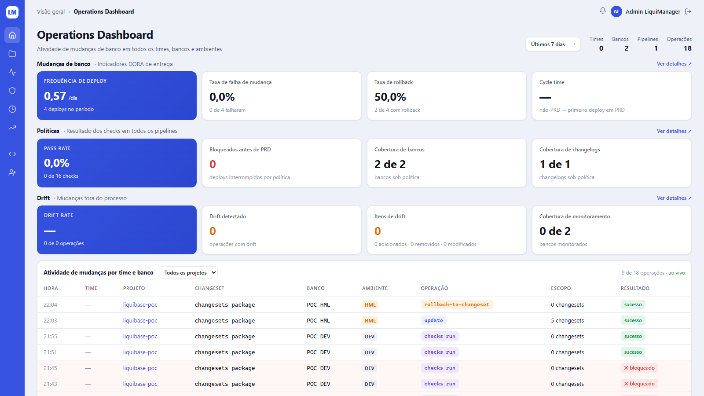

### 5.2 Acessos e Permissões

Primeiro passo depois de entrar: ligue **grupos** (os do seu SSO) a **papéis** e escopos (workspace, projeto, conexão, pipeline ou ambiente).
Os pedidos de acesso de quem entrou sem papel aparecem aqui. Quando os grupos estiverem ligados, **retire `oidc.bootstrapAdmins`** e rode `helm upgrade`.

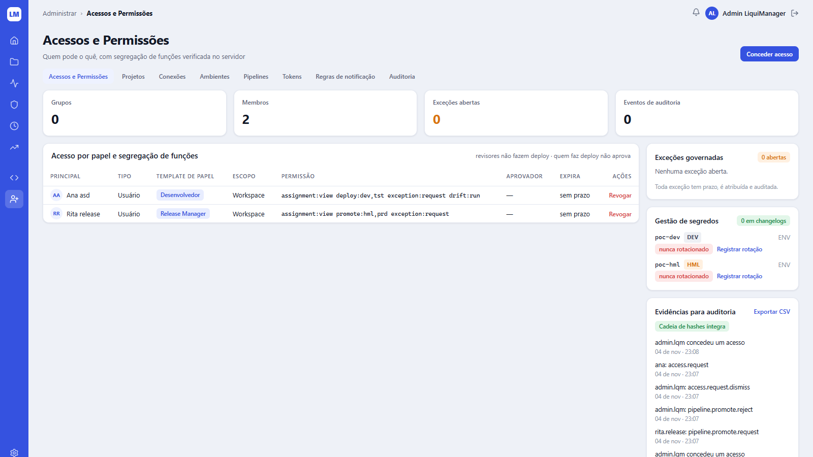

### 5.3 Ambientes

Os ambientes (DEV, HML, PRD…) já vêm do seed; confira e ajuste o que a sua organização usa.

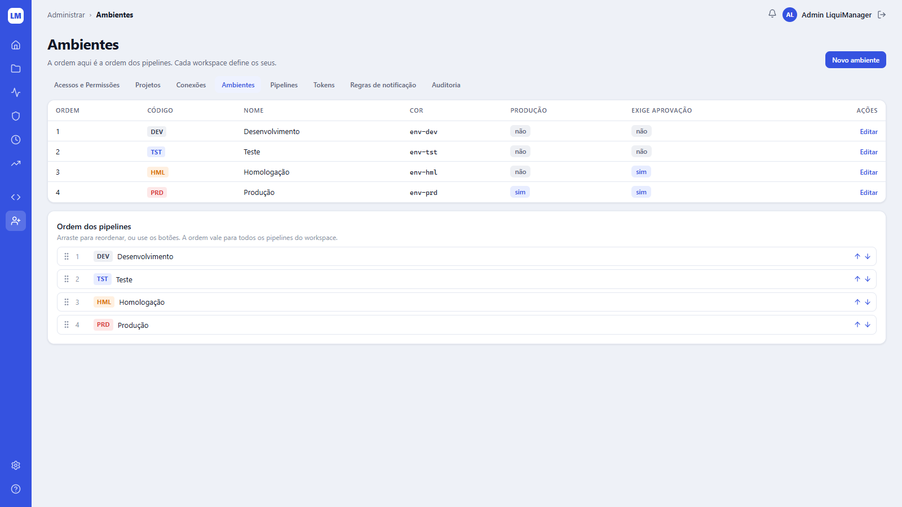

### 5.4 Projetos

Um projeto é uma aplicação com o seu repositório de changelogs (a `repo_url` é usada para ler arquivos e relacionar MRs).

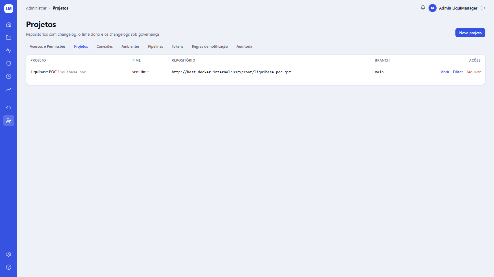

### 5.5 Conexões

Uma conexão é um banco físico ou lógico em um ambiente. O LiquiManager **não guarda senha**: a URL JDBC vai sem usuário e senha e a conexão leva só a
**referência ao segredo** (Vault, Consul, Azure Key Vault ou variável de ambiente), resolvida em memória e com cache de até 5 minutos.
É aqui que se liga o monitoramento de **drift** e o **scanner** de cada banco, e que se testa a conexão.

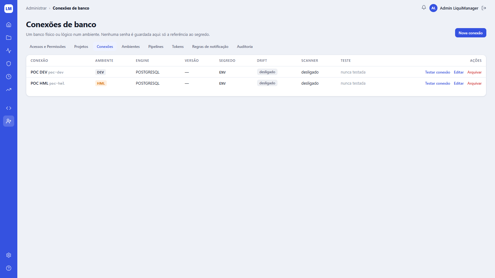

### 5.6 Pipelines

O pipeline define a **ordem dos ambientes** (por exemplo DEV → HML → PRD). É ele que impede promover para HML algo que ainda não passou por DEV
e que alimenta a matriz de promoção.

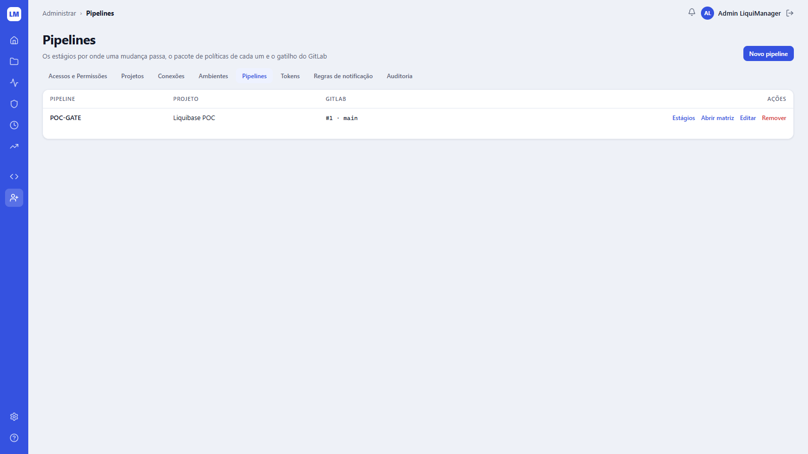

### 5.7 Tokens de serviço

Credenciais dos coletores, do runner e do webhook do GitLab. O valor aparece **uma única vez**, na criação. Escopos usuais:

| Uso | Escopos |
|-----|---------|
| Esteira (`lqm update`) e starter | `ingest` (e `checks:read` para `lqm checks run`) |
| Runner de rollback | `runner` e `ingest` |
| Webhook do GitLab | `webhook` |

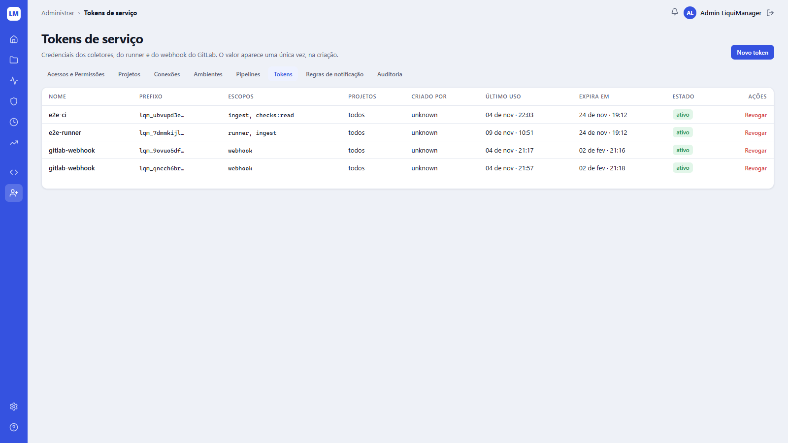

### 5.8 Políticas

Os **checks** (51 configuráveis em 7 categorias, mais 4 de processo) são avaliados antes do deploy; um check bloqueante pode barrar o `update`.
A severidade que vale é a do **pacote** atribuído.

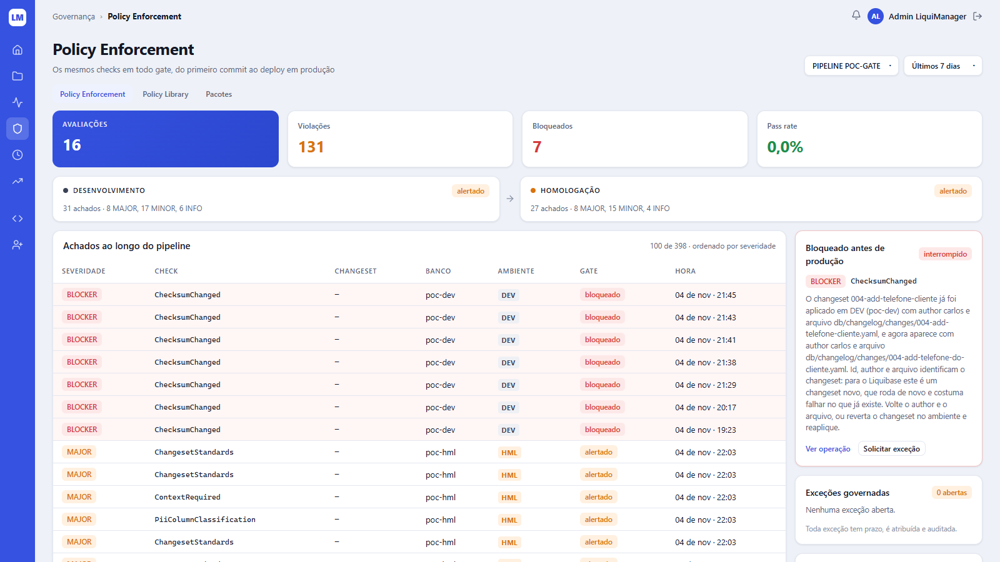
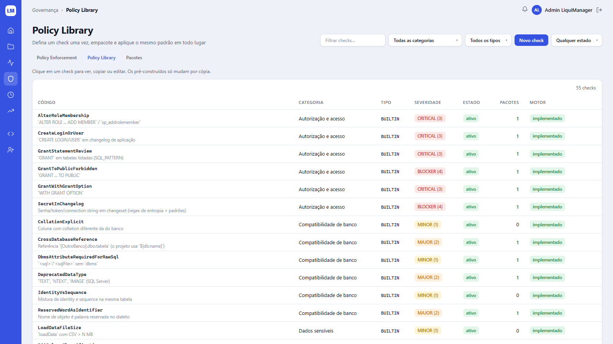
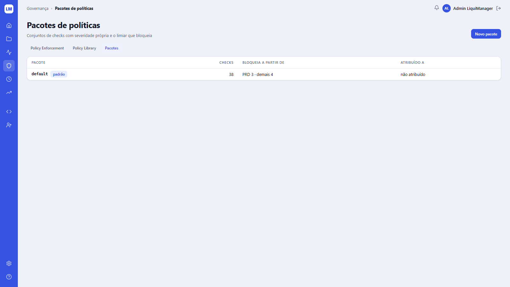

### 5.9 Notificações e auditoria

Regras de notificação por evento e a trilha de auditoria encadeada.

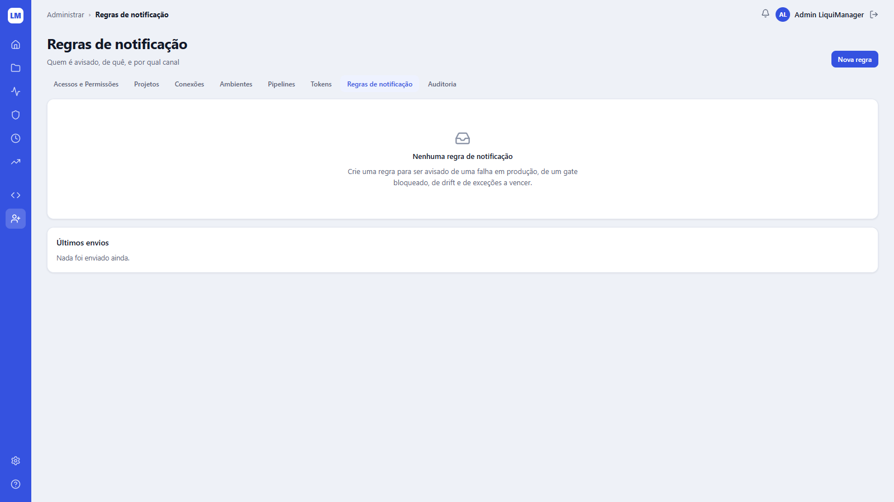
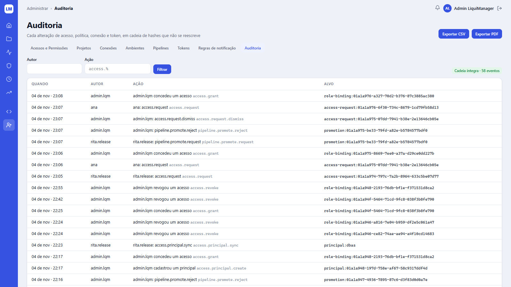

## 6. Ligando os serviços e as esteiras

### 6.1 Esteira do GitLab (CLI `lqm`)

A imagem `lqm-cli` roda o comando na esteira. Exemplo mínimo:

```yaml
.lqm:
  image: carloslimadocker/lqm-cli:1.1.0
  variables:
    LQM_URL: https://lqm.exemplo.com/api/v1
    LQM_PROJECT: $CI_PROJECT_NAME
    # LQM_TOKEN: variável mascarada do grupo, com escopo ingest

lqm-checks:                                # em todo MR; não toca o banco
  extends: .lqm
  stage: test
  script: [ "lqm checks run --env=$LQM_TARGET_ENV --changelog-file=src/main/resources/db/changelog/db.changelog-master.xml" ]
  rules: [ { if: '$CI_PIPELINE_SOURCE == "merge_request_event"' } ]

db-migrate-hml:
  extends: .lqm
  stage: deploy-hml
  variables: { LQM_ENV: HML, LQM_CONNECTION_KEY: core-hml }
  script: [ "lqm update --env=$LQM_ENV --connection-key=$LQM_CONNECTION_KEY --url=$DB_URL --changelog-file=src/main/resources/db/changelog/db.changelog-master.xml" ]
```

### 6.2 Serviço Spring Boot (starter)

Para serviços que rodam Liquibase no startup, adicione o `lqm-spring-boot-starter` e configure `lqm.url`, `lqm.token` (de um Secret), `lqm.project`
e `lqm.environment` (veja a documentação do starter). Os coletores são **fail-open**: a indisponibilidade do LiquiManager nunca
impede um deploy, salvo `lqm.enforce.failClosed=true`.

### 6.3 Webhook do GitLab (MR fechado ou reaberto)

Cadastre um **system hook** (o webhook de grupo é GitLab Premium) para `https://<host>/api/v1/integrations/gitlab/webhook`, com o **segredo** igual a
um token de serviço de escopo `webhook`. Assim um MR fechado encerra sozinho o grupo em revisão no projeto. 

### 6.4 Runner de rollback

Habilite com `runner.enabled=true` e informe os Secrets (`tokenSecret`, `gitUrlSecret` e `dbCredentialsSecret`). Ele só precisa de rede até o
LiquiManager, o servidor git e os bancos alvo, e **não precisa de nenhuma permissão na API do Kubernetes**. Ao ser substituído, termina o rollback em andamento.

## 7. Telas para conhecer

| Tela | Para quê |
|------|----------|
| Operações | Toda execução (`update`, `rollback`, `checks run`, `flow`…) com resultado e escopo |
| Matriz de promoção | Changeset × ambiente, com **Promover**, rollback e quem está aguardando |
| Projetos | O hub de cada projeto: changelogs, changesets em revisão (MRs), rollback até um changeset |
| Developer Mode | O changelog do repositório com o estado em produção de cada changeset |
| Drift | O que mudou no banco fora do processo |

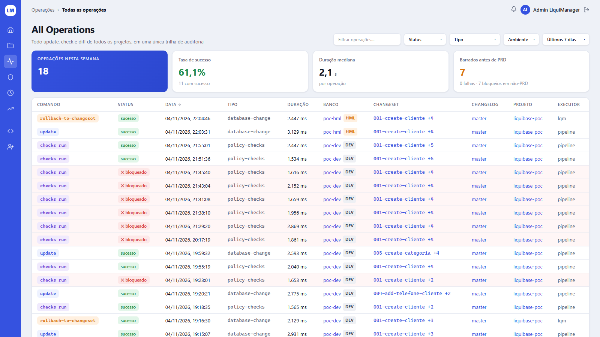
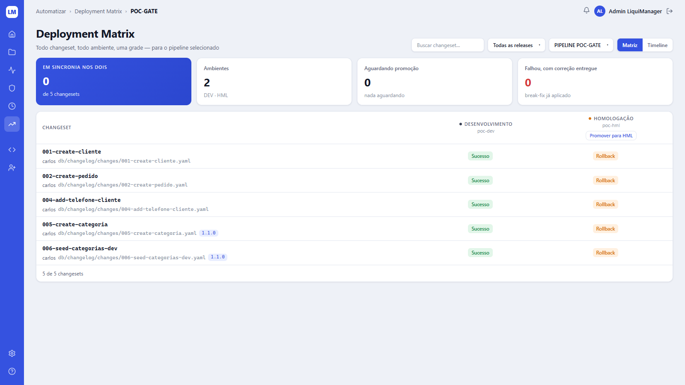
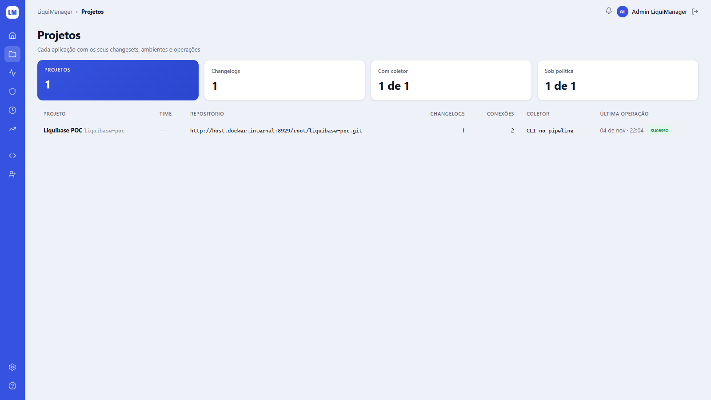
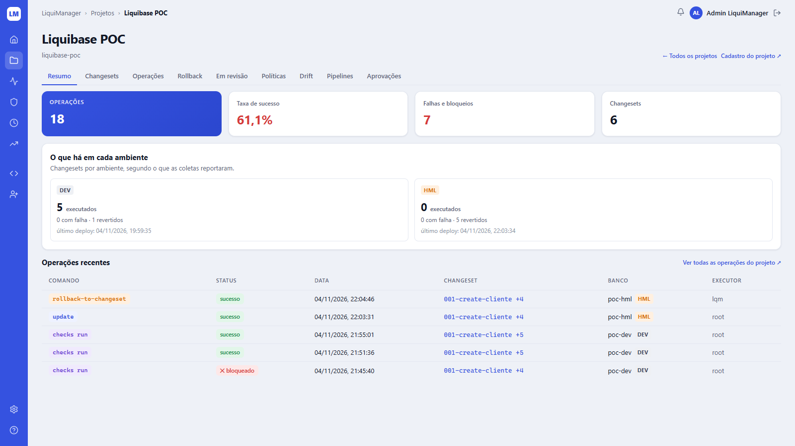
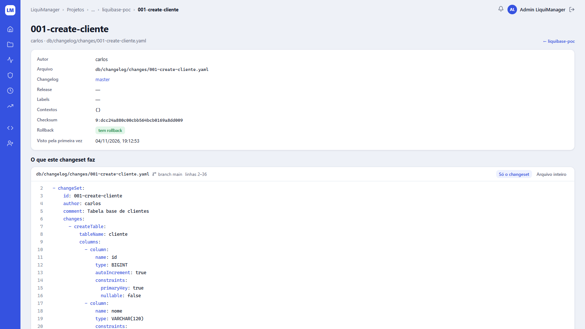
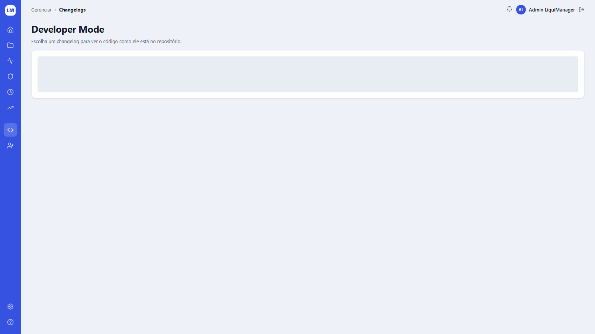
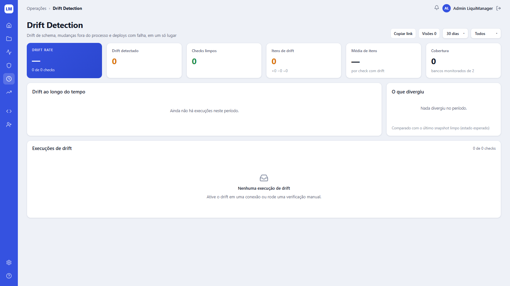

## 8. Solução de problemas

| Sintoma | Causa provável |
|---------|----------------|
| Pod da API reiniciando na primeira subida | O schema ainda está sendo criado; aumente `api.startupProbe.failureThreshold`. Veja `kubectl -n lqm logs deploy/lqm-liquimanager-api` |
| `helm install` recusa com "exige storage.type=s3" | Mais de uma réplica (ou worker) com armazenamento local; configure `storage.s3.*` |
| Login em loop ou 401 em tudo | `oidc.issuerUri` diferente do `iss` do token (precisa ser o endereço que o **navegador** usa) ou token sem a audiência `lqm-api` |
| Entrei e as telas ficam vazias, 403 | Esperado: o padrão é nenhum acesso. Use `oidc.bootstrapAdmins` para a primeira concessão |
| O feed ao vivo não atualiza atrás do ingress | O ingress está bufferizando o SSE. Com `ingress.className=nginx` o chart já ajusta; com outro controlador, desligue o buffering e use leitura longa em `/api/` |
| Um log de operação não abre | Mais de uma réplica com armazenamento local: cada uma guarda os logs no próprio diretório. Use S3 |

## Estado deste chart

Validado com `helm lint` e `helm template` (mínimo e produção completa, com réplicas, worker, runner, ingress com TLS e S3), conferindo as variáveis
contra a configuração da API. **Ainda não foi instalado em um cluster real**: se encontrar algo, abra uma issue com a versão do Kubernetes, do Helm e o
trecho do `values` (sem segredos).

## Contribuindo

Pull requests são bem-vindos, no chart e na aplicação. Para o código, leia o [`CONTRIBUTING.md`](../CONTRIBUTING.md);
para o chart, rode `helm lint helm/liquimanager -f helm/values-producao.example.yaml` e um `helm template` com as combinações que você mexeu. O `LICENSE` é Apache 2.0; o Liquibase que o produto usa tem licença própria (FSL), que cobre uso interno.

## Publicando o chart (mantenedores)

A cada versão nova, suba o `version` do `helm/liquimanager/Chart.yaml` (e o `appVersion`, se as imagens mudaram) e publique:

```bash
helm package helm/liquimanager
```

```bash
helm registry login registry-1.docker.io -u carloslimadocker
```

```bash
helm push liquimanager-0.2.0.tgz oci://registry-1.docker.io/carloslimadocker
```

O Docker Hub cria o repositório `carloslimadocker/liquimanager` no primeiro push (de tipo "chart OCI"; deixe-o público).
